# 🃏 La Longère aux Pierres Grises — Atlas visuel du deck

> **Source :** `DeckV8.md` (règles `deckV7.3`) · **24 cartes** (23 cartes du deck + 1 carte technique) · **7 jours** · **3 voies de victoire**
> **Contenu :** pour **chaque carte**, un diagramme qui montre tous ses choix, leurs conditions, leurs gains/pertes de ressources, le devenir de la carte jouée (conservée, défaussée, supprimée, mise en mémoire) et les cartes qu'elle fait apparaître (**J0 immédiat**, **J0 plus tard**, **J+1**).
> **Lecture :** les diagrammes sont en [Mermaid](https://mermaid.js.org/) ; ils s'affichent dans GitHub, GitLab, Obsidian, Typora, VS Code (aperçu Markdown avec extension Mermaid) et Notion (bloc code Mermaid).

---

## 0. Comment lire les diagrammes

### 0.1 Anatomie d'un diagramme de carte

```
🃏 Carte jouée  ──►  Choix n° (code, nom, conditions 🔒, effets ▸, compteurs 📈)
                          │
                          ├──►  Pile de destination de la carte jouée (vert / gris / rouge / orange)
                          └──►  ➕ Carte(s) ajoutée(s) avec leur timing (violet)  ·  🏆 victoire (jaune)
```

### 0.2 Code couleur

| Couleur | Signification |
| :--- | :--- |
| 🟦 Bleu | La carte étudiée |
| 🟥 Rouge vif (cadre épais) | La carte étudiée est une **menace** |
| 🟩 Vert | Carte **conservée** (`tomorrow_deck`, revient à J+1) — choix `[B]` |
| ⬜ Gris | Carte **défaussée** (`discard_recoverable`, repêchable) — choix `A` classique |
| 🟥 Rose | Carte **supprimée** (`removed_forever`) — choix `A` permanent |
| 🟧 Orange | Carte **mise en sommeil** (`memory`) — choix `C1` |
| 🟪 Violet | **Nouvelle carte** ajoutée par le choix |
| 🟨 Jaune | **Victoire** / choix **verrouillé** (🔐) conditionnant une Voie |

### 0.3 Types de flèches (timing d'ajout d'une carte)

| Flèche | Code | Timing | Détail |
| :---: | :---: | :--- | :--- |
| `══►` (épaisse) | **A2** | **J0 · immédiat** | Insérée en tête du deck du jour (index 0) : c'est la prochaine carte piochée. |
| `──►` | **A3** | **J0 · plus tard dans la journée** | Insérée à l'index ≥ 1 du deck du jour. **Forcée en immédiat dès J6**, ou si le deck du jour contient ≤ 1 carte. |
| `┄┄►` (pointillée) | **A4 / C1** | **J+1 · demain** | Ajoutée au `tomorrow_deck`, mélangée à l'aube. **Forcée en immédiat au J7** (ne s'applique jamais aux retours `[B]`). |

### 0.4 Codes des choix

| Code | Effet | Devenir de la carte jouée |
| :---: | :--- | :--- |
| **B** | Gains/pertes (+ éventuel `xp` / `endurance`) | 📥 **Conservée** → `tomorrow_deck` (revient à J+1) |
| **B + A2/A3/A4** | Idem + ajoute une autre carte | 📥 **Conservée** (la carte jouée reste en jeu) |
| **A1** | Gains/pertes uniquement | ♻️ **Défaussée** (`discard_recoverable`) |
| **A2 / A3 / A4** | Gains/pertes + ajoute une carte | ♻️ **Défaussée** |
| **A1 / A2 / A4 perm** | Idem mais permanent | 🗑️ **Supprimée** (`removed_forever`) |
| **C1** | Amélioration, reconversion ou retour | 💤 **`memory`** + nouvelle carte demain |

### 0.5 Ressources et abréviations

| Abrév. | Ressource | Départ | Bornes / règles |
| :---: | :--- | :---: | :--- |
| **V** | Points de vie | 3 | 0..3 · défaite à 0 |
| **Én** | Énergie | 6 | 0..max (6, 7 à endurance 2, 8 à endurance 4) · à 0 : -1 Vie puis Énergie = 3 |
| **T** | Tension | 0 | 0..6 · à seuil (6, ou 5 si Én ≤ 2) : -1 Vie puis Tension = 3 |
| **Arg** | Argent | 2 | ≥ 0 |
| **P** | Plaisir | 1 | 0..5 |
| **L** | Légumes | 1 | 0..8 |
| **I** | Indices | 0 | ≥ 0 |
| **xp.*** | `potager`, `sport`, `enquete`, `repos`, `cueillette` | 0 | conservés à vie · paliers de constance à 3 |
| **endurance** | Compteur d'endurance | 0 | à 2 → max Én 7 · à 4 → max Én 8 (+1 Én immédiat à chaque palier) |

**Autres signes :** `Acte` = acte notarié payé (c1_17) · `Clé` = Clé de la Source (c1_18) · `nb` = nombre de spécialités actives parmi c1_07 / c1_09 / c1_10 · « 1re spé. » = `nb = 0` · « 2e+ spé. » = `nb ≥ 1` (polymath).

### 0.6 Règles transversales qui expliquent les diagrammes

1. **Anti-doublon :** une seule occurrence d'une carte dans `day_deck + tomorrow_deck + carte en cours`. Une carte supprimée n'est jamais ajoutée.
2. **Choix inopérants masqués :** un choix dont toutes les cibles sont supprimées ou déjà actives n'est pas proposé.
3. **Sûreté d'Énergie :** tout choix conditionnel d'investissement / parade / amélioration exige `Én ≥ coût + 1`.
4. **La victoire prime :** un choix qui active une `inv.voie_*` ignore les contrôles de survie du tour.
5. **Ordre de résolution :** conditions → gains/pertes (plancher 0, plafonds Vie 3, Plaisir 5, Légumes 8) → compteurs et drapeaux → routage de la carte jouée → exils → ajouts → `check_survival`.

---

## 1. Vues d'ensemble du deck

### 1.1 Cycle de vie d'une carte : les 5 piles

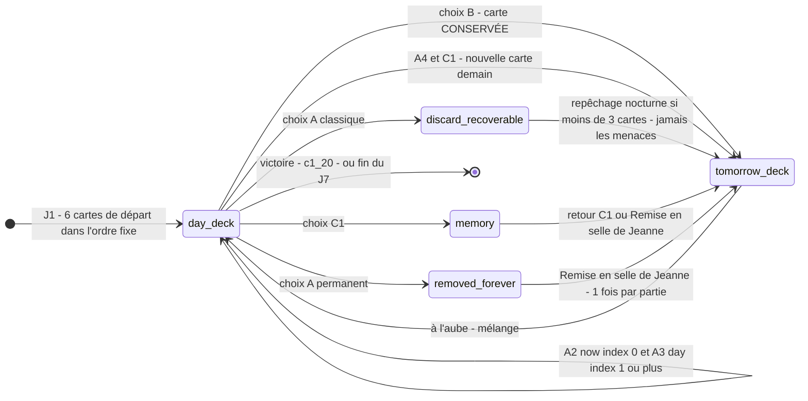

### 1.2 Calendrier des 7 jours

```mermaid
flowchart LR
  classDef card fill:#bfdbfe,stroke:#1d4ed8,stroke-width:3px,color:#000
  classDef thr fill:#fecaca,stroke:#b91c1c,stroke-width:3px,color:#000
  classDef ck fill:#f0fdf4,stroke:#15803d,color:#000
  classDef cd fill:#f3f4f6,stroke:#4b5563,color:#000
  classDef cx fill:#fef2f2,stroke:#b91c1c,color:#000
  classDef cm fill:#fff7ed,stroke:#c2410c,color:#000
  classDef cw fill:#fef9c3,stroke:#a16207,stroke-width:3px,color:#000
  classDef pk fill:#86efac,stroke:#15803d,color:#000
  classDef pd fill:#d1d5db,stroke:#4b5563,color:#000
  classDef px fill:#fca5a5,stroke:#b91c1c,color:#000
  classDef pm fill:#fdba74,stroke:#c2410c,color:#000
  classDef nw fill:#e9d5ff,stroke:#6d28d9,color:#000
  classDef win fill:#fde047,stroke:#a16207,stroke-width:3px,color:#000
  J1["📅 J1<br/>6 cartes de départ<br/>c1_01 → c1_06 dans l'ordre"]:::card
  J2["📅 J2<br/>c1_13 Colporteur<br/>spontané · sauf cloche retirée"]:::nw
  J3["📅 J3<br/>c1_17 Notaire<br/>menace centrale · Acte 5 Arg"]:::thr
  J4["📅 J4<br/>c1_14 Marché du bourg<br/>spontané"]:::nw
  J5["📅 J5<br/>c1_21 Nuit de grêle<br/>menace"]:::thr
  J6["📅 J6<br/>c1_22 Inspection<br/>menace · A3 forcé en now dès J6<br/>Acte 7 Arg"]:::thr
  J7["📅 J7<br/>dernier jour · A4 et C1 forcés en now<br/>Acte 8 Arg · jamais pour les B"]:::cx
  FIN["🌙 Nuit du J7<br/>SURVIE si Acte et Vie ≥ 1<br/>sinon TEMPS ÉCOULÉ"]:::win
  J1 --> J2 --> J3 --> J4 --> J5 --> J6 --> J7 --> FIN
```

> Le calendrier n'ajoute une carte que si elle n'est pas déjà en `removed_forever` ni déjà présente (`is_present`). Prix du notaire : **5 Arg jusqu'au J4, 6 au J5, 7 au J6, 8 au J7**.

### 1.3 Séquence exacte de la nuit (`end_of_day`)

```mermaid
flowchart TD
  classDef card fill:#bfdbfe,stroke:#1d4ed8,stroke-width:3px,color:#000
  classDef thr fill:#fecaca,stroke:#b91c1c,stroke-width:3px,color:#000
  classDef ck fill:#f0fdf4,stroke:#15803d,color:#000
  classDef cd fill:#f3f4f6,stroke:#4b5563,color:#000
  classDef cx fill:#fef2f2,stroke:#b91c1c,color:#000
  classDef cm fill:#fff7ed,stroke:#c2410c,color:#000
  classDef cw fill:#fef9c3,stroke:#a16207,stroke-width:3px,color:#000
  classDef pk fill:#86efac,stroke:#15803d,color:#000
  classDef pd fill:#d1d5db,stroke:#4b5563,color:#000
  classDef px fill:#fca5a5,stroke:#b91c1c,color:#000
  classDef pm fill:#fdba74,stroke:#c2410c,color:#000
  classDef nw fill:#e9d5ff,stroke:#6d28d9,color:#000
  classDef win fill:#fde047,stroke:#a16207,stroke-width:3px,color:#000
  S0(["🌙 end_of_day"]):::card
  S1["1. Déclencheurs de fin de journée<br/>(avant +2 Énergie et Surmenage)<br/>• J ≥ 2, Légumes ≥ 5, c1_16 non résolue, cooldown = 0 → c1_16 demain<br/>• cooldown = max(0, cooldown - 1)<br/>• Énergie ≤ 1 → c1_15 demain<br/>• J ≥ 3 et Vie ≤ 2 (1 fois) → c1_12 demain<br/>• J ≥ 3 et Arg ≤ 1 (1 fois) → c1_12 demain"]:::nw
  S2["2. Apaisement<br/>Plaisir ≥ 1 : -1P et -1T (-2T si xp.repos ≥ 3)<br/>sinon +1T (plafonné à seuil - 1)"]:::cd
  S3["3. Surmenage<br/>si au moins 2 spécialités actives dans tomorrow_deck :<br/>Énergie = max(1, Én - 1) et +1T"]:::cm
  S4["4. Récupération<br/>Énergie = min(max_énergie, Én + 2)"]:::ck
  S5["5. Passage au jour suivant<br/>J + 1 · si J dépasse 7 : SURVIE ou TEMPS ÉCOULÉ"]:::card
  S6["6. Calendrier<br/>J2 c1_13 · J3 c1_17 · J4 c1_14 · J5 c1_21 · J6 c1_22<br/>(si non supprimée et non présente)"]:::nw
  S7["7. Mélange et garde-fou<br/>tomorrow_deck mélangé · si moins de 3 cartes : repêche dans discard_recoverable<br/>(hors menaces) · si vide : c1_secours Journée calme"]:::cd
  S8["8. Annonces et survie<br/>threat_announced pour chaque menace du day_deck<br/>puis check_survival"]:::thr
  S0 --> S1 --> S2 --> S3 --> S4 --> S5 --> S6 --> S7 --> S8
```

### 1.4 Les 3 voies de victoire

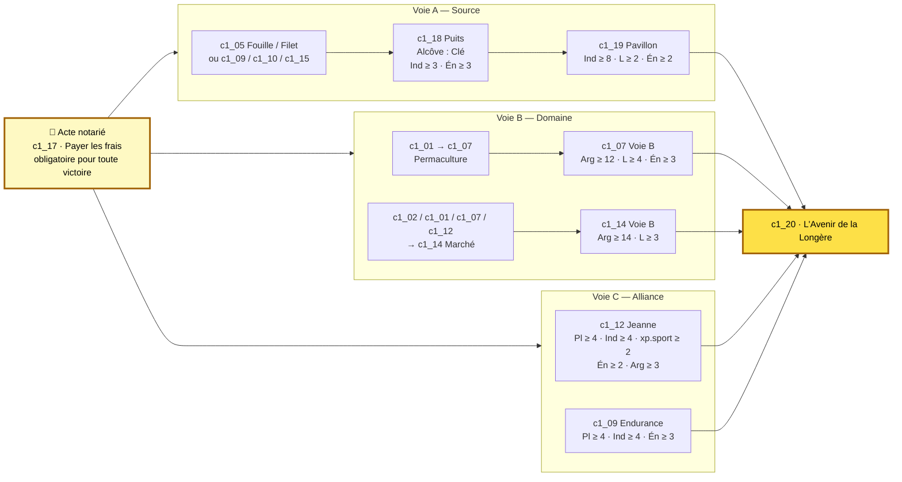

### 1.5 Carte des liens entre les 23 cartes

> Lecture : une flèche **A → B** signifie que A peut faire apparaître B. Épaisse = **J0 immédiat** · pleine = **J0 plus tard** · pointillée = **J+1 / déclencheur de nuit ou calendrier**.

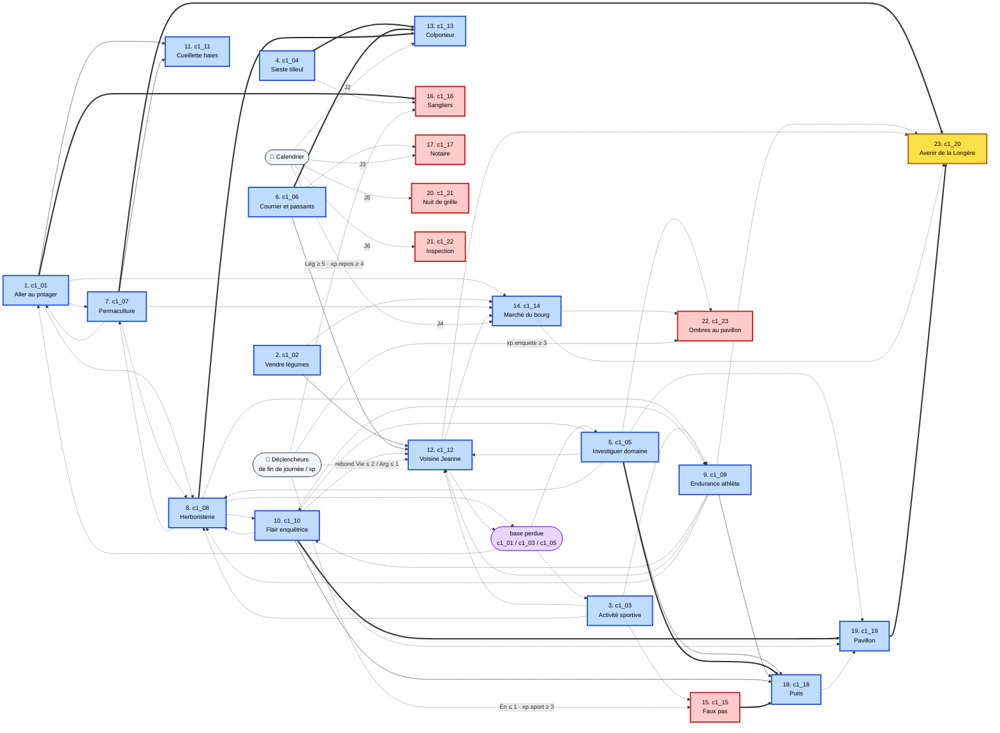

---

## 2. Les 24 cartes, une par une

## 🃏 Carte 1 — `c1_01_aller_potager` · Aller au potager

| Type | Image de fond | Lieu | Rôle |
| :--- | :--- | :--- | :--- |
| `COMPETENCE` | `carte01_campagne_potager.png` | Potager clos à l'aube | Socle agricole (Légumes, xp.potager) conservé sur toutes ses variantes. |

**Comment la carte arrive en jeu**

- **J1 — carte de départ n°1** (ordre fixe c1_01→c1_06)
- Retour depuis `memory` : c1_07 « Retour » (J+1), c1_08 « Retour base » (J+1), Jeanne « Remise en selle » (J+1)

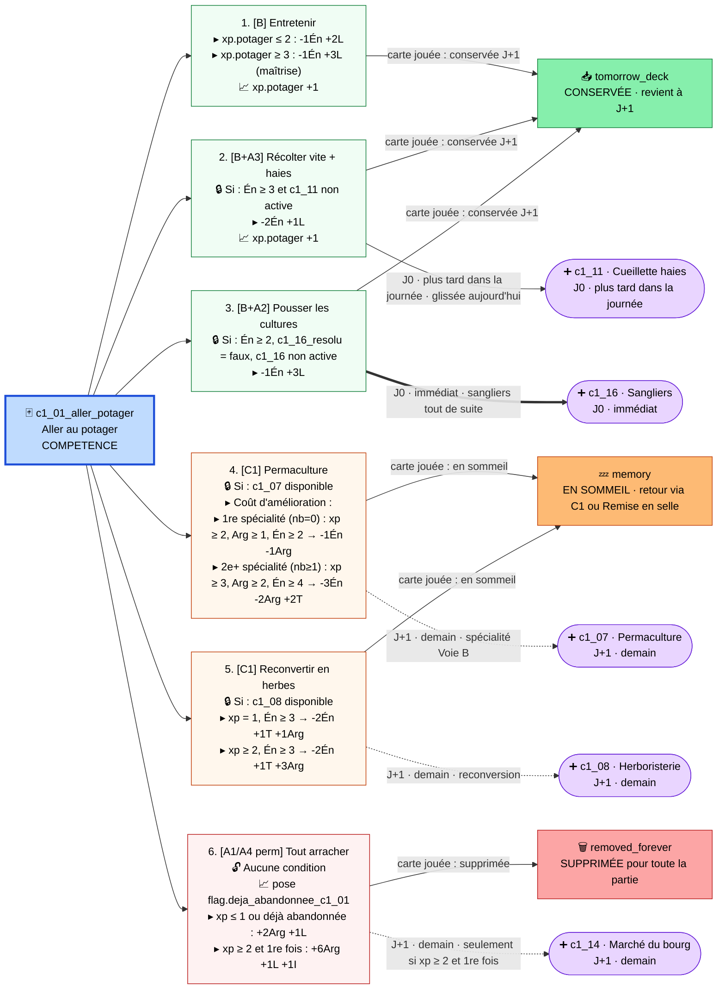

**Points clés**

- Faille corrigée : si c1_01 est en `memory` puis c1_08 vendue définitivement, la « Remise en selle » de Jeanne la récupère.
- Le choix B+A2 est masqué si c1_16 est déjà active ou résolue (choix inopérant masqué).

---

## 🃏 Carte 2 — `c1_02_vendre_legumes` · Vendre ses légumes au portail

| Type | Image de fond | Lieu | Rôle |
| :--- | :--- | :--- | :--- |
| `ACTIVITE` | `carte02_campagne_etal_legumes.png` | Portail et tréteaux | Convertisseur Légumes → Argent (-1 Én), conservé hors liquidation. |

**Comment la carte arrive en jeu**

- **J1 — carte de départ n°2**

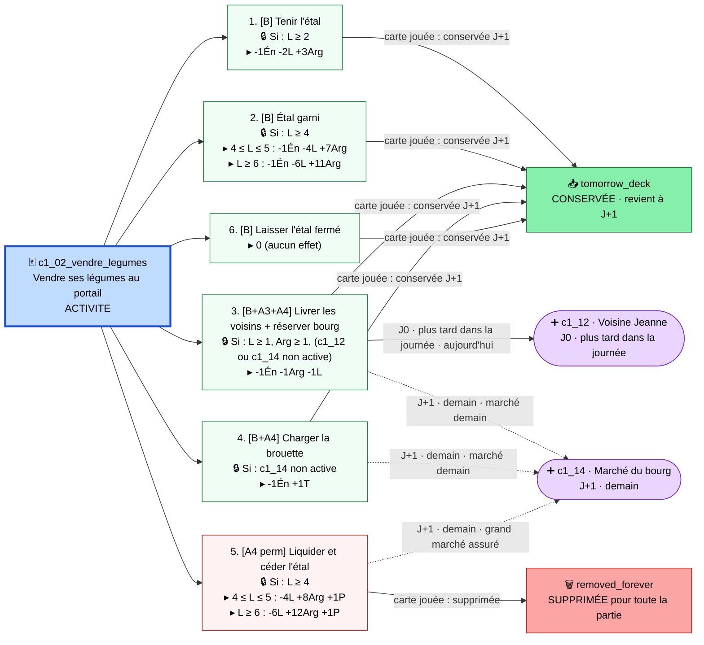

**Points clés**

- Seule l'option « Liquider » supprime la carte ; toutes les autres la conservent pour demain.

---

## 🃏 Carte 3 — `c1_03_activite_sportive` · Activité sportive dans les chemins

| Type | Image de fond | Lieu | Rôle |
| :--- | :--- | :--- | :--- |
| `COMPETENCE` | `carte03_campagne_sport.png` | Chemin creux boisé | Vitalité, Plaisir, endurance (max Én 7 puis 8), xp.cueillette. |

**Comment la carte arrive en jeu**

- **J1 — carte de départ n°3**
- Retour depuis `memory` : c1_08 « Retour base » (J+1), Jeanne « Remise en selle » (J+1)

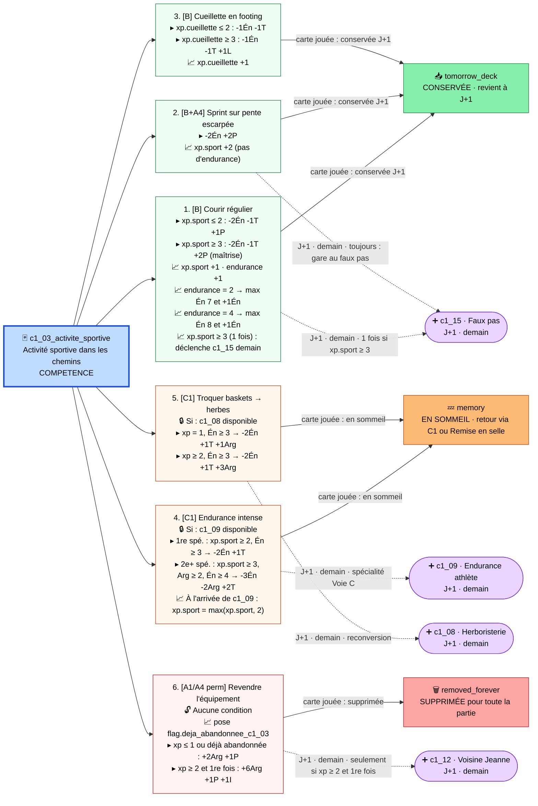

**Points clés**

- Les paliers d'endurance (2 et 4) relèvent l'Énergie maximale et donnent +1 Énergie immédiate.
- Le Sprint déclenche toujours c1_15 ; Courir ne la déclenche qu'une fois, dès xp.sport ≥ 3 (drapeau unique).

---

## 🃏 Carte 4 — `c1_04_sieste_tilleul` · Faire la sieste sous le tilleul

| Type | Image de fond | Lieu | Rôle |
| :--- | :--- | :--- | :--- |
| `ACTIVITE` | `carte04_campagne_sieste.png` | Hamac sous le tilleul | Régulation Énergie / Tension et conversion Légumes → Énergie. |

**Comment la carte arrive en jeu**

- **J1 — carte de départ n°4**

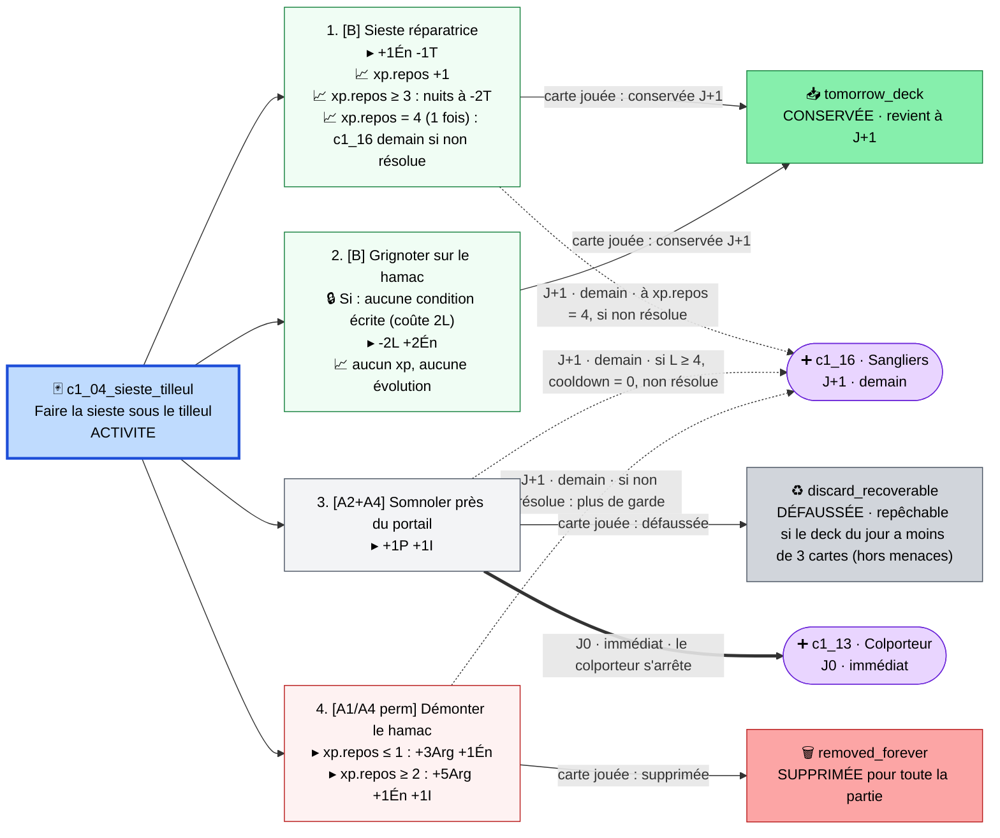

**Points clés**

- Seule carte dont la sieste construit un « excès de flânerie » : xp.repos ≥ 4 appelle les sangliers (1 fois).

---

## 🃏 Carte 5 — `c1_05_investiguer_domaine` · Investiguer le domaine

| Type | Image de fond | Lieu | Rôle |
| :--- | :--- | :--- | :--- |
| `COMPETENCE` | `carte05_campagne_enquete.png` | Archives et bornes | Socle Voie A (Indices, xp.enquete). |

**Comment la carte arrive en jeu**

- **J1 — carte de départ n°5**
- Retour depuis `memory` : c1_08 « Retour base » (J+1), Jeanne « Remise en selle » (J+1)

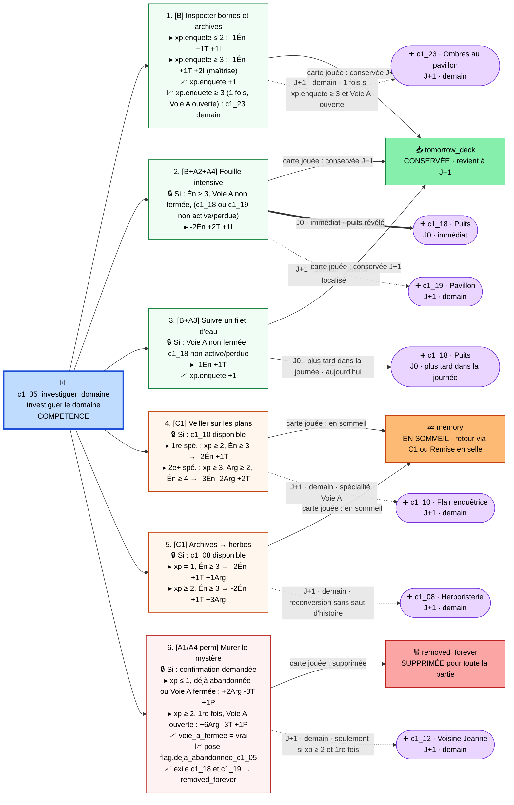

**Points clés**

- Murer ferme définitivement la Voie A : c1_18 et c1_19 sont exilées.
- Les choix « Fouille » et « Filet d'eau » sont masqués si c1_18/c1_19 sont déjà actives ou perdues.

---

## 🃏 Carte 6 — `c1_06_courrier_et_route` · Le courrier et les passants

| Type | Image de fond | Lieu | Rôle |
| :--- | :--- | :--- | :--- |
| `EVENEMENT` | `carte06_campagne_courrier.png` | Portail communal | Aiguillage J1 : commerce, alliance, notaire ou silence. |

**Comment la carte arrive en jeu**

- **J1 — carte de départ n°6** (jamais conservée : aucun choix [B])

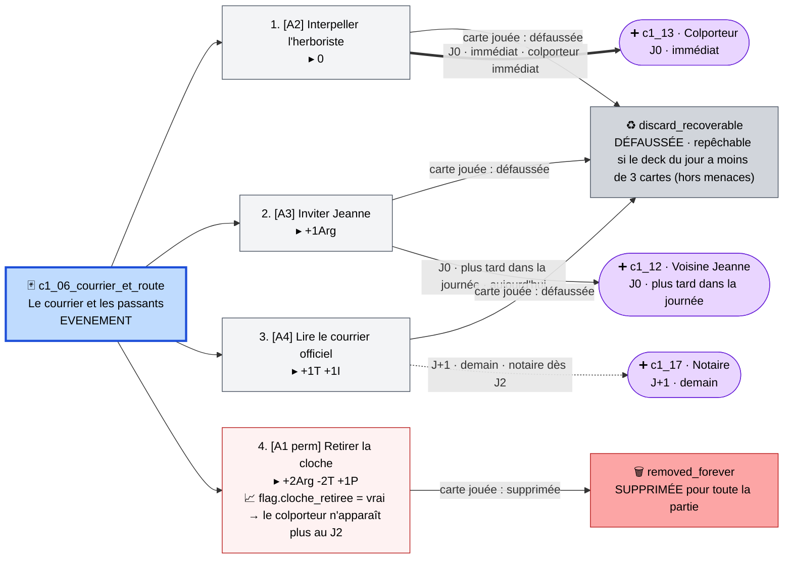

**Points clés**

- Règle « histoire = moins de gains » : les trois choix qui ouvrent l'histoire rapportent peu.

---

## 🃏 Carte 7 — `c1_07_potager_permaculture` · Potager en permaculture

| Type | Image de fond | Lieu | Rôle |
| :--- | :--- | :--- | :--- |
| `COMPETENCE_AVANCEE` | `carte07_campagne_permaculture.png` | Buttes paillées | Spécialité Voie B (+5 Légumes), bail cessible, pivot vers c1_08 / retour c1_01. |

**Comment la carte arrive en jeu**

- Ajoutée **J+1** par c1_01 « Permaculture » (C1) et c1_08 « → c1_07 » (C1)

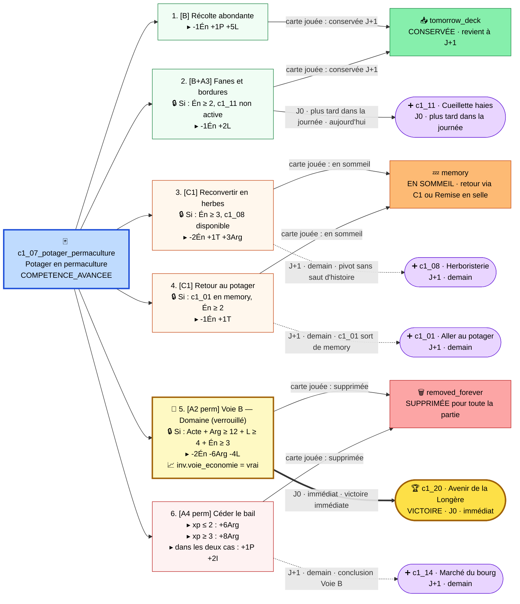

**Points clés**

- Le choix Voie B est verrouillé tant que ses conditions ne sont pas toutes réunies ; il ignore ensuite les contrôles de survie du tour (la victoire prime).

---

## 🃏 Carte 8 — `c1_08_herboristerie_jardin` · Jardin d'herbes médicinales

| Type | Image de fond | Lieu | Rôle |
| :--- | :--- | :--- | :--- |
| `COMPETENCE_AVANCEE` | `carte08_campagne_herboristerie.png` | Appentis et alambic | Carrefour d'argent direct (+3 Arg) et plaque tournante des reconversions. |

**Comment la carte arrive en jeu**

- Ajoutée **J+1** par c1_01 / c1_03 / c1_05 (reconversion C1), c1_07 / c1_09 / c1_10 (pivot C1)

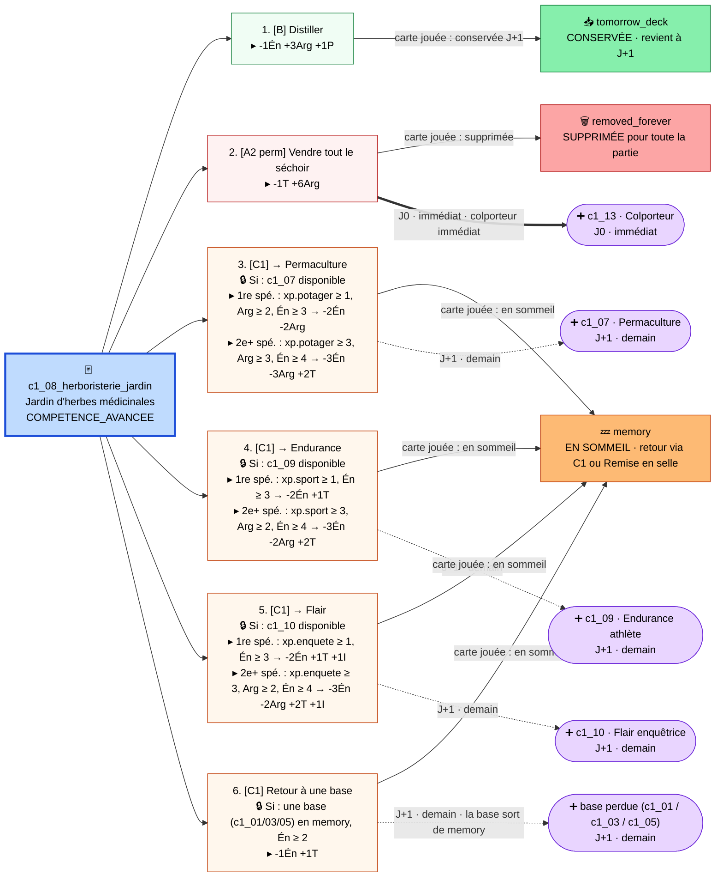

**Points clés**

- Si c1_08 est vendue définitivement, les bases restées en `memory` ne peuvent plus revenir que par la « Remise en selle » de Jeanne.

---

## 🃏 Carte 9 — `c1_09_endurance_athletique` · Endurance d'athlète

| Type | Image de fond | Lieu | Rôle |
| :--- | :--- | :--- | :--- |
| `COMPETENCE_AVANCEE` | `carte09_campagne_endurance.png` | Sentier de crête | Spécialité Voie C ; relève l'Énergie max jusqu'à 8. |

**Comment la carte arrive en jeu**

- Ajoutée **J+1** par c1_03 (C1), c1_08 (C1), c1_10 (C1) — force xp.sport ≥ 2 à l'arrivée

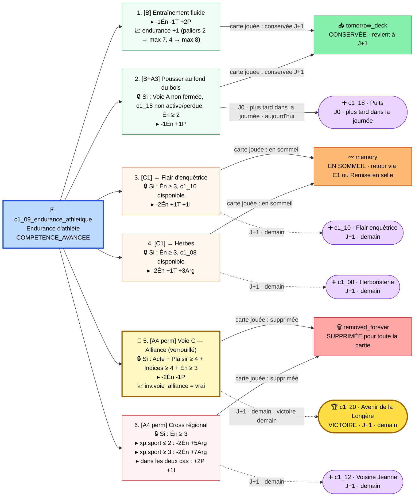

**Points clés**

- Contrairement à la Voie B (A2 immédiate), la Voie C se conclut en A4 : c1_20 arrive à J+1 (ou J0 si J7).

---

## 🃏 Carte 10 — `c1_10_flair_enquetrice` · Flair d'enquêtrice

| Type | Image de fond | Lieu | Rôle |
| :--- | :--- | :--- | :--- |
| `COMPETENCE_AVANCEE` | `carte10_campagne_enquete_carnet.png` | Bureau tardif | Spécialité Voie A (+2 Indices) ; localise Puits puis Pavillon sans jamais bloquer la Voie A. |

**Comment la carte arrive en jeu**

- Ajoutée **J+1** par c1_05 (C1), c1_08 (C1), c1_09 (C1)

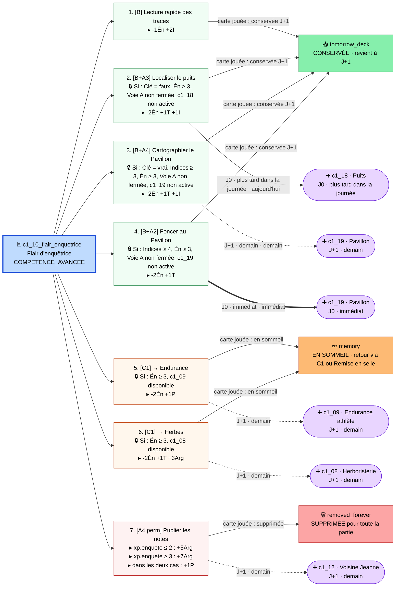

**Points clés**

- Le choix « Localiser » a deux variantes mutuellement exclusives selon la Clé (puits si Clé absente, Pavillon si Clé obtenue).

---

## 🃏 Carte 11 — `c1_11_cueillette_haies` · Cueillette dans les haies

| Type | Image de fond | Lieu | Rôle |
| :--- | :--- | :--- | :--- |
| `ACTIVITE` | `carte11_campagne_haies.png` | Haies sauvages | Garde-manger ponctuel, 100 % consommable (A1), dopé par xp.cueillette ≥ 2. |

**Comment la carte arrive en jeu**

- Ajoutée **J0 plus tard (A3)** par c1_01 « Récolter vite » et c1_07 « Fanes et bordures »

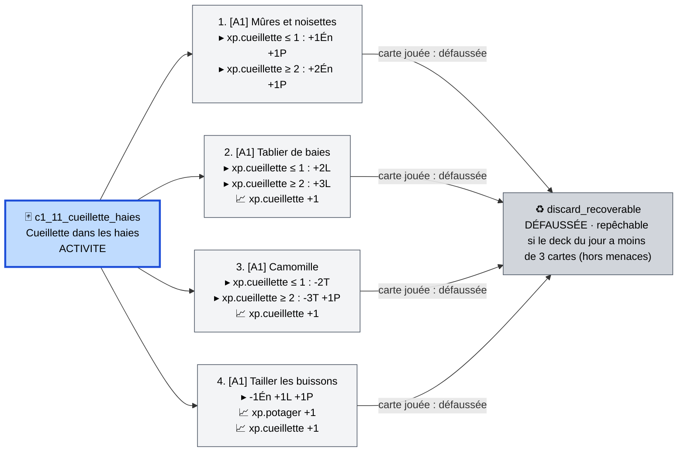

**Points clés**

- Consommable : aucun choix [B], la carte ne reste jamais dans le deck du jour.
- Elle n'est jamais appelée en boucle : aucune boucle d'Énergie infinie via c1_01.

---

## 🃏 Carte 12 — `c1_12_voisine_jeanne` · La voisine Jeanne

| Type | Image de fond | Lieu | Rôle |
| :--- | :--- | :--- | :--- |
| `RENCONTRE` | `carte12_campagne_voisine_jeanne.png` | Clôture mitoyenne | Alliée sociale, filet unique (Remise en selle, memory inclus) et conclusion Voie C. |

**Comment la carte arrive en jeu**

- **J0 plus tard (A3)** : c1_02 « Livrer voisins », c1_06 « Inviter Jeanne »
- **J+1** : c1_03 « Revendre » et c1_05 « Murer » (xp ≥ 2, 1re fois), c1_09 « Cross régional », c1_10 « Publier les notes »
- **Rebond de fin de journée (J ≥ 3)** : 1 fois si Vie ≤ 2, 1 fois si Arg ≤ 1

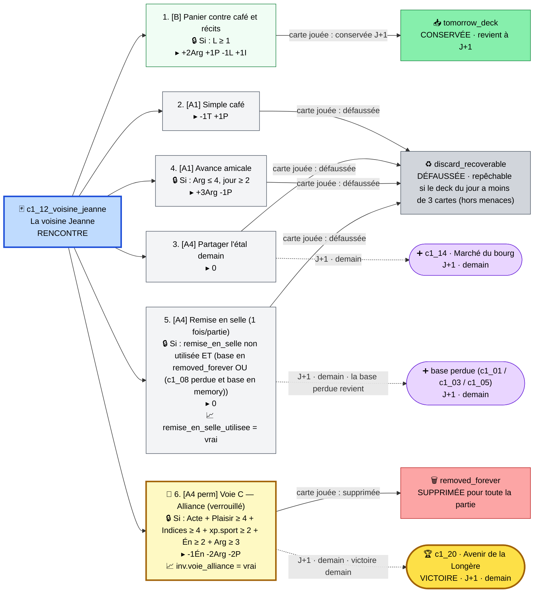

**Points clés**

- Un seul choix conserve la carte (Panier) ; tous les autres la défaussent ou la suppriment.
- La Remise en selle est la seule façon de sortir une compétence de `removed_forever`.

---

## 🃏 Carte 13 — `c1_13_colporteur_herboriste` · Le colporteur herboriste

| Type | Image de fond | Lieu | Rôle |
| :--- | :--- | :--- | :--- |
| `RENCONTRE` | `carte13_campagne_colporteur.png` | Charreton au portail | Compensateur universel (Argent, Tension, Énergie, Légumes, Plaisir, Indices). |

**Comment la carte arrive en jeu**

- **J2 — calendrier spontané** (sauf si flag.cloche_retiree)
- **J0 immédiat (A2)** : c1_06 « Interpeller l'herboriste », c1_04 « Somnoler », c1_08 « Vendre le séchoir »

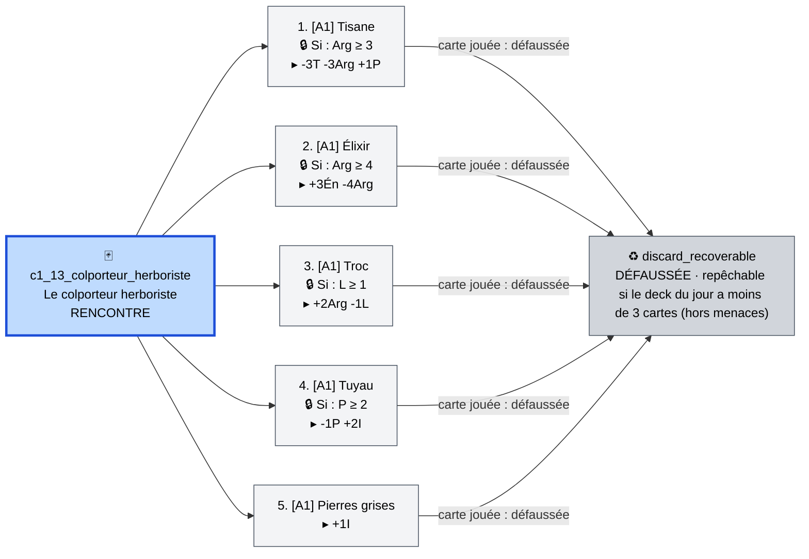

**Points clés**

- Les 5 choix sont des A1 : la carte est défaussée (repêchable) quel que soit le choix.
- Au J2, l'événement calendrier est annulé si la cloche a été retirée (c1_06) ou si la carte est déjà supprimée/présente.

---

## 🃏 Carte 14 — `c1_14_marche_du_bourg` · Le grand marché du bourg

| Type | Image de fond | Lieu | Rôle |
| :--- | :--- | :--- | :--- |
| `EVENEMENT` | `carte14_campagne_marche.png` | Place du bourg | Marché spontané J4, xp.enquete et conclusion Voie B. |

**Comment la carte arrive en jeu**

- **J4 — calendrier spontané**
- **J+1** : c1_01 « Tout arracher » (xp ≥ 2), c1_02 (Livrer / Brouette / Liquider), c1_07 « Céder le bail », c1_12 « Partager l'étal »

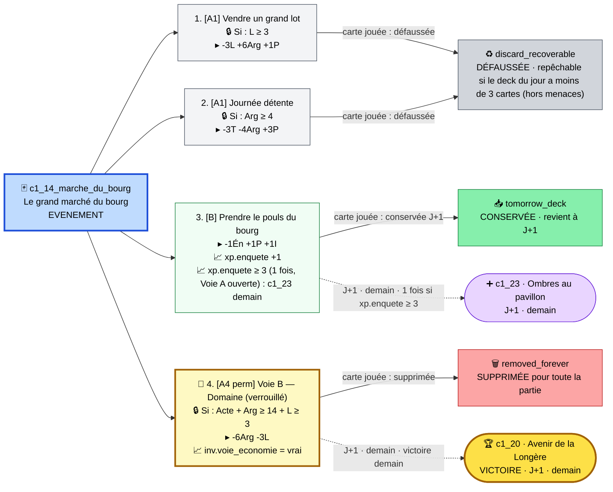

**Points clés**

- Règle « histoire = moins de gains » : la conclusion de Voie B coûte cher et ne rapporte aucune ressource.

---

## 🃏 Carte 15 — `c1_15_faux_pas_sentier` · Faux pas sur le sentier

| Type | Image de fond | Lieu | Rôle |
| :--- | :--- | :--- | :--- |
| `MENACE` | `carte12_campagne_faux_pas.png` | Talus pierreux | Menace physique (fatigue, Sprint). Multi-solutions + temporisation. |

**Comment la carte arrive en jeu**

- **Fin de journée → J+1** : Énergie ≤ 1 (chaque soir)
- **J+1** : xp.sport ≥ 3 (1 fois, drapeau c1_15_fatigue_xp) ; c1_03 « Sprint » (toujours)

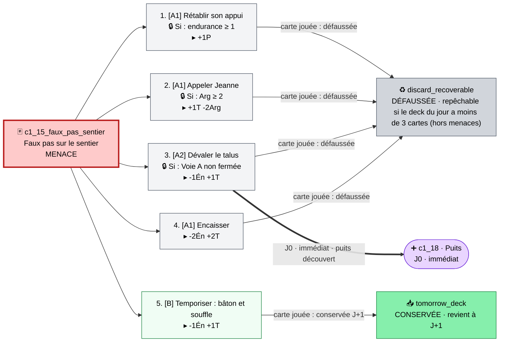

**Points clés**

- Toutes les options de résolution défaussent la carte (elle ne revient que par un nouveau déclencheur) ; seule la temporisation la renvoie demain.
- Menace exclue du repêchage « garde-fou : moins de 3 cartes ».

---

## 🃏 Carte 16 — `c1_16_sangliers_potager` · Sangliers au potager

| Type | Image de fond | Lieu | Rôle |
| :--- | :--- | :--- | :--- |
| `MENACE` | `carte16_campagne_sangliers.png` | Potager à l'aube | Menace d'avidité : 3 parades définitives + 1 parade d'attente + 1 temporisation. |

**Comment la carte arrive en jeu**

- **Fin de journée → J+1** : J ≥ 2, Légumes ≥ 5, non résolue, cooldown = 0
- **J0 immédiat** : c1_01 « Pousser les cultures » ; **J+1** : c1_04 « Démonter », c1_04 « Somnoler » (L ≥ 4), xp.repos = 4 (1 fois)

```mermaid
flowchart LR
  classDef card fill:#bfdbfe,stroke:#1d4ed8,stroke-width:3px,color:#000
  classDef thr fill:#fecaca,stroke:#b91c1c,stroke-width:3px,color:#000
  classDef ck fill:#f0fdf4,stroke:#15803d,color:#000
  classDef cd fill:#f3f4f6,stroke:#4b5563,color:#000
  classDef cx fill:#fef2f2,stroke:#b91c1c,color:#000
  classDef cm fill:#fff7ed,stroke:#c2410c,color:#000
  classDef cw fill:#fef9c3,stroke:#a16207,stroke-width:3px,color:#000
  classDef pk fill:#86efac,stroke:#15803d,color:#000
  classDef pd fill:#d1d5db,stroke:#4b5563,color:#000
  classDef px fill:#fca5a5,stroke:#b91c1c,color:#000
  classDef pm fill:#fdba74,stroke:#c2410c,color:#000
  classDef nw fill:#e9d5ff,stroke:#6d28d9,color:#000
  classDef win fill:#fde047,stroke:#a16207,stroke-width:3px,color:#000
  CARD["🃏 c1_16_sangliers_potager<br/>Sangliers au potager<br/>MENACE"]:::thr
  K1["1. [A1 perm] Clôture<br/>🔒 Si : Arg ≥ 3, Én ≥ 2<br/>▸ -1Én -3Arg<br/>📈 flag.c1_16_resolu = vrai"]:::cx
  CARD --> K1
  K1 -->|"carte jouée : supprimée"| PX
  K2["2. [A1 perm] Pourchasser<br/>🔒 Si : xp.sport ≥ 2, Én ≥ 3<br/>▸ -2Én +1P<br/>📈 flag.c1_16_resolu = vrai"]:::cx
  CARD --> K2
  K2 -->|"carte jouée : supprimée"| PX
  K3["3. [A1 perm] Répulsif de baies<br/>🔒 Si : xp.cueillette ≥ 2, Én ≥ 2<br/>▸ -1Én +1I<br/>📈 flag.c1_16_resolu = vrai"]:::cx
  CARD --> K3
  K3 -->|"carte jouée : supprimée"| PX
  K4["4. [A1] Épouvantail<br/>🔒 Si : Én ≥ 2, L ≥ 1<br/>▸ -1Én -1L<br/>📈 cooldown = 2 (nuits sans retour auto)"]:::cd
  CARD --> K4
  K4 -->|"carte jouée : défaussée"| PD
  K5["5. [B] Temporiser : casserole<br/>▸ -1Én +1T -1L"]:::ck
  CARD --> K5
  K5 -->|"carte jouée : conservée J+1"| PK
  PK["📥 tomorrow_deck<br/>CONSERVÉE · revient à J+1"]:::pk
  PD["♻️ discard_recoverable<br/>DÉFAUSSÉE · repêchable si le deck du jour a moins de 3 cartes (hors menaces)"]:::pd
  PX["🗑️ removed_forever<br/>SUPPRIMÉE pour toute la partie"]:::px
```

**Points clés**

- Seules les trois parades « perm » règlent définitivement la menace.
- L'Épouvantail défausse la carte : elle peut revenir quand cooldown = 0 et Légumes ≥ 5.

---

## 🃏 Carte 17 — `c1_17_courrier_notaire` · Courrier du notaire

| Type | Image de fond | Lieu | Rôle |
| :--- | :--- | :--- | :--- |
| `MENACE_CENTRALE` | `carte17_campagne_notaire.png` | Enveloppe scellée | Seule menace centrale : l'Acte conditionne toutes les victoires et la survie. |

**Comment la carte arrive en jeu**

- **J3 — calendrier**
- **J+1** : c1_06 « Lire le courrier officiel » (dès J2)

```mermaid
flowchart LR
  classDef card fill:#bfdbfe,stroke:#1d4ed8,stroke-width:3px,color:#000
  classDef thr fill:#fecaca,stroke:#b91c1c,stroke-width:3px,color:#000
  classDef ck fill:#f0fdf4,stroke:#15803d,color:#000
  classDef cd fill:#f3f4f6,stroke:#4b5563,color:#000
  classDef cx fill:#fef2f2,stroke:#b91c1c,color:#000
  classDef cm fill:#fff7ed,stroke:#c2410c,color:#000
  classDef cw fill:#fef9c3,stroke:#a16207,stroke-width:3px,color:#000
  classDef pk fill:#86efac,stroke:#15803d,color:#000
  classDef pd fill:#d1d5db,stroke:#4b5563,color:#000
  classDef px fill:#fca5a5,stroke:#b91c1c,color:#000
  classDef pm fill:#fdba74,stroke:#c2410c,color:#000
  classDef nw fill:#e9d5ff,stroke:#6d28d9,color:#000
  classDef win fill:#fde047,stroke:#a16207,stroke-width:3px,color:#000
  CARD["🃏 c1_17_courrier_notaire<br/>Courrier du notaire<br/>MENACE_CENTRALE"]:::thr
  K1["1. [A1 perm] Payer les frais<br/>🔒 Si : Arg ≥ prix du jour<br/>▸ J ≤ 4 : -5Arg<br/>▸ J5 : -6Arg<br/>▸ J6 : -7Arg<br/>▸ J7 : -8Arg<br/>▸ dans tous les cas : +1I<br/>📈 Acte = vrai"]:::cx
  CARD --> K1
  K1 -->|"carte jouée : supprimée"| PX
  K2["2. [B] Temporiser : repousser<br/>▸ +2T"]:::ck
  CARD --> K2
  K2 -->|"carte jouée : conservée J+1"| PK
  PK["📥 tomorrow_deck<br/>CONSERVÉE · revient à J+1"]:::pk
  PX["🗑️ removed_forever<br/>SUPPRIMÉE pour toute la partie"]:::px
```

**Points clés**

- Le prix augmente chaque jour (5 → 8 Arg) : temporiser coûte de la Tension ET du prix.
- Sans Acte à la fin du J7 : écran TEMPS_ÉCOULÉ (pas de Survie).

---

## 🃏 Carte 18 — `c1_18_puits_pierres_grises` · Le puits aux pierres grises

| Type | Image de fond | Lieu | Rôle |
| :--- | :--- | :--- | :--- |
| `MYSTERE` | `carte18_campagne_puits.png` | Puits mousseux | Clé de la Source (Voie A) ou vente irréversible +5 Arg. |

**Comment la carte arrive en jeu**

- **J0 immédiat (A2)** : c1_05 « Fouille », c1_15 « Dévaler le talus »
- **J0 plus tard (A3)** : c1_05 « Filet d'eau », c1_09 « Pousser au fond du bois », c1_10 « Localiser le puits »

```mermaid
flowchart LR
  classDef card fill:#bfdbfe,stroke:#1d4ed8,stroke-width:3px,color:#000
  classDef thr fill:#fecaca,stroke:#b91c1c,stroke-width:3px,color:#000
  classDef ck fill:#f0fdf4,stroke:#15803d,color:#000
  classDef cd fill:#f3f4f6,stroke:#4b5563,color:#000
  classDef cx fill:#fef2f2,stroke:#b91c1c,color:#000
  classDef cm fill:#fff7ed,stroke:#c2410c,color:#000
  classDef cw fill:#fef9c3,stroke:#a16207,stroke-width:3px,color:#000
  classDef pk fill:#86efac,stroke:#15803d,color:#000
  classDef pd fill:#d1d5db,stroke:#4b5563,color:#000
  classDef px fill:#fca5a5,stroke:#b91c1c,color:#000
  classDef pm fill:#fdba74,stroke:#c2410c,color:#000
  classDef nw fill:#e9d5ff,stroke:#6d28d9,color:#000
  classDef win fill:#fde047,stroke:#a16207,stroke-width:3px,color:#000
  CARD["🃏 c1_18_puits_pierres_grises<br/>Le puits aux pierres grises<br/>MYSTERE"]:::card
  K1["1. [B] Boire<br/>▸ -1T"]:::ck
  CARD --> K1
  K1 -->|"carte jouée : conservée J+1"| PK
  K2["2. [A4] Descendre dans l'alcôve<br/>🔒 Si : Clé = faux, Indices ≥ 3, Én ≥ 3, Voie A non fermée<br/>▸ -2Én +2T +2I<br/>📈 Clé = vrai"]:::cd
  CARD --> K2
  K2 -->|"carte jouée : défaussée"| PD
  K2 -.->|"J+1 · demain · pavillon demain"| N19tom
  K3["3. [A1] Couvrir le puits<br/>▸ -1T"]:::cd
  CARD --> K3
  K3 -->|"carte jouée : défaussée"| PD
  K4["4. [A1 perm] Vendre le secret<br/>🔒 Si : confirmation demandée<br/>▸ +5Arg +1P<br/>📈 voie_a_fermee = vrai<br/>📈 exile c1_19 → removed_forever"]:::cx
  CARD --> K4
  K4 -->|"carte jouée : supprimée"| PX
  PK["📥 tomorrow_deck<br/>CONSERVÉE · revient à J+1"]:::pk
  PD["♻️ discard_recoverable<br/>DÉFAUSSÉE · repêchable si le deck du jour a moins de 3 cartes (hors menaces)"]:::pd
  PX["🗑️ removed_forever<br/>SUPPRIMÉE pour toute la partie"]:::px
  N19tom(["➕ c1_19 · Pavillon<br/>J+1 · demain"]):::nw
```

**Points clés**

- « Vendre » ferme irréversiblement la Voie A.

---

## 🃏 Carte 19 — `c1_19_pavillon_scelle` · Le Pavillon de la Source

| Type | Image de fond | Lieu | Rôle |
| :--- | :--- | :--- | :--- |
| `MYSTERE` | `carte19_campagne_pavillon.png` | Édifice octogonal | Sanctuaire final de la Voie A. |

**Comment la carte arrive en jeu**

- **J0 immédiat (A2)** : c1_10 « Foncer au Pavillon »
- **J+1** : c1_05 « Fouille », c1_10 « Cartographier », c1_18 « Alcôve »

```mermaid
flowchart LR
  classDef card fill:#bfdbfe,stroke:#1d4ed8,stroke-width:3px,color:#000
  classDef thr fill:#fecaca,stroke:#b91c1c,stroke-width:3px,color:#000
  classDef ck fill:#f0fdf4,stroke:#15803d,color:#000
  classDef cd fill:#f3f4f6,stroke:#4b5563,color:#000
  classDef cx fill:#fef2f2,stroke:#b91c1c,color:#000
  classDef cm fill:#fff7ed,stroke:#c2410c,color:#000
  classDef cw fill:#fef9c3,stroke:#a16207,stroke-width:3px,color:#000
  classDef pk fill:#86efac,stroke:#15803d,color:#000
  classDef pd fill:#d1d5db,stroke:#4b5563,color:#000
  classDef px fill:#fca5a5,stroke:#b91c1c,color:#000
  classDef pm fill:#fdba74,stroke:#c2410c,color:#000
  classDef nw fill:#e9d5ff,stroke:#6d28d9,color:#000
  classDef win fill:#fde047,stroke:#a16207,stroke-width:3px,color:#000
  CARD["🃏 c1_19_pavillon_scelle<br/>Le Pavillon de la Source<br/>MYSTERE"]:::card
  K1["🔐 1. [A2 perm] Voie A — Source (verrouillé)<br/>🔒 Si : Clé + Acte + Indices ≥ 8 + L ≥ 2 + Én ≥ 2<br/>▸ -1Én -2L<br/>📈 inv.voie_mystere = vrai"]:::cw
  CARD --> K1
  K1 -->|"carte jouée : supprimée"| PX
  K1 ==>|"J0 · immédiat · victoire immédiate"| N20now
  K2["2. [B] Étudier les glyphes<br/>▸ -1Én +1T +1I"]:::ck
  CARD --> K2
  K2 -->|"carte jouée : conservée J+1"| PK
  K3["3. [B] Repartir<br/>▸ -1P"]:::ck
  CARD --> K3
  K3 -->|"carte jouée : conservée J+1"| PK
  PK["📥 tomorrow_deck<br/>CONSERVÉE · revient à J+1"]:::pk
  PX["🗑️ removed_forever<br/>SUPPRIMÉE pour toute la partie"]:::px
  N20now(["🏆 c1_20 · Avenir de la Longère<br/>VICTOIRE · J0 · immédiat"]):::win
```

**Points clés**

- Deux choix [B] gardent la carte tant que les conditions d'entrée de la Voie A ne sont pas réunies.

---

## 🃏 Carte 20 — `c1_21_nuit_de_grele` · Nuit de grêle

| Type | Image de fond | Lieu | Rôle |
| :--- | :--- | :--- | :--- |
| `MENACE` | `carte21_campagne_grele.png` | Potager sous orage | Menace programmée J5, multi-solutions + temporisation. |

**Comment la carte arrive en jeu**

- **J5 — calendrier**

```mermaid
flowchart LR
  classDef card fill:#bfdbfe,stroke:#1d4ed8,stroke-width:3px,color:#000
  classDef thr fill:#fecaca,stroke:#b91c1c,stroke-width:3px,color:#000
  classDef ck fill:#f0fdf4,stroke:#15803d,color:#000
  classDef cd fill:#f3f4f6,stroke:#4b5563,color:#000
  classDef cx fill:#fef2f2,stroke:#b91c1c,color:#000
  classDef cm fill:#fff7ed,stroke:#c2410c,color:#000
  classDef cw fill:#fef9c3,stroke:#a16207,stroke-width:3px,color:#000
  classDef pk fill:#86efac,stroke:#15803d,color:#000
  classDef pd fill:#d1d5db,stroke:#4b5563,color:#000
  classDef px fill:#fca5a5,stroke:#b91c1c,color:#000
  classDef pm fill:#fdba74,stroke:#c2410c,color:#000
  classDef nw fill:#e9d5ff,stroke:#6d28d9,color:#000
  classDef win fill:#fde047,stroke:#a16207,stroke-width:3px,color:#000
  CARD["🃏 c1_21_nuit_de_grele<br/>Nuit de grêle<br/>MENACE"]:::thr
  K1["1. [A1 perm] Bâches<br/>🔒 Si : Arg ≥ 2, Én ≥ 2<br/>▸ -1Én -2Arg"]:::cx
  CARD --> K1
  K1 -->|"carte jouée : supprimée"| PX
  K2["2. [A1 perm] Cloches de paille<br/>🔒 Si : xp.potager ≥ 2, Én ≥ 2<br/>▸ -1Én +1P"]:::cx
  CARD --> K2
  K2 -->|"carte jouée : supprimée"| PX
  K3["3. [A1 perm] Rentrer vite<br/>🔒 Si : xp.sport ≥ 2, Én ≥ 3<br/>▸ -2Én"]:::cx
  CARD --> K3
  K3 -->|"carte jouée : supprimée"| PX
  K4["4. [A1 perm] Abri de branchages<br/>🔒 Si : xp.cueillette ≥ 2, Én ≥ 2<br/>▸ -1Én +1P"]:::cx
  CARD --> K4
  K4 -->|"carte jouée : supprimée"| PX
  K5["5. [A1 perm] Subir (s'abriter)<br/>▸ +2T -3L"]:::cx
  CARD --> K5
  K5 -->|"carte jouée : supprimée"| PX
  K6["6. [B] Temporiser : colmater<br/>▸ -1Én -1L"]:::ck
  CARD --> K6
  K6 -->|"carte jouée : conservée J+1"| PK
  PK["📥 tomorrow_deck<br/>CONSERVÉE · revient à J+1"]:::pk
  PX["🗑️ removed_forever<br/>SUPPRIMÉE pour toute la partie"]:::px
```

**Points clés**

- Une parade définitive supprime la carte ; « Subir » est toujours disponible (pas de blocage).

---

## 🃏 Carte 21 — `c1_22_visite_inspection` · Visite d'inspection

| Type | Image de fond | Lieu | Rôle |
| :--- | :--- | :--- | :--- |
| `MENACE` | `carte22_campagne_inspection.png` | Portail et voiture grise | Contrôle J6 qui valorise l'Acte, avec temporisation 24 h. |

**Comment la carte arrive en jeu**

- **J6 — calendrier**

```mermaid
flowchart LR
  classDef card fill:#bfdbfe,stroke:#1d4ed8,stroke-width:3px,color:#000
  classDef thr fill:#fecaca,stroke:#b91c1c,stroke-width:3px,color:#000
  classDef ck fill:#f0fdf4,stroke:#15803d,color:#000
  classDef cd fill:#f3f4f6,stroke:#4b5563,color:#000
  classDef cx fill:#fef2f2,stroke:#b91c1c,color:#000
  classDef cm fill:#fff7ed,stroke:#c2410c,color:#000
  classDef cw fill:#fef9c3,stroke:#a16207,stroke-width:3px,color:#000
  classDef pk fill:#86efac,stroke:#15803d,color:#000
  classDef pd fill:#d1d5db,stroke:#4b5563,color:#000
  classDef px fill:#fca5a5,stroke:#b91c1c,color:#000
  classDef pm fill:#fdba74,stroke:#c2410c,color:#000
  classDef nw fill:#e9d5ff,stroke:#6d28d9,color:#000
  classDef win fill:#fde047,stroke:#a16207,stroke-width:3px,color:#000
  CARD["🃏 c1_22_visite_inspection<br/>Visite d'inspection<br/>MENACE"]:::thr
  K1["1. [A1 perm] Présenter l'Acte<br/>🔒 Si : Acte = vrai<br/>▸ -1T +1P"]:::cx
  CARD --> K1
  K1 -->|"carte jouée : supprimée"| PX
  K2["2. [A1 perm] Relevés cadastraux<br/>🔒 Si : Indices ≥ 4, Én ≥ 2<br/>▸ -1Én +1T"]:::cx
  CARD --> K2
  K2 -->|"carte jouée : supprimée"| PX
  K3["3. [A1 perm] Appui de Jeanne<br/>🔒 Si : Plaisir ≥ 3<br/>▸ -1P +1T"]:::cx
  CARD --> K3
  K3 -->|"carte jouée : supprimée"| PX
  K4["4. [A1 perm] Payer l'amende<br/>🔒 Si : Arg ≥ 3<br/>▸ +1T -3Arg"]:::cx
  CARD --> K4
  K4 -->|"carte jouée : supprimée"| PX
  K5["5. [A1 perm] Encaisser le blâme<br/>▸ +3T -1P"]:::cx
  CARD --> K5
  K5 -->|"carte jouée : supprimée"| PX
  K6["6. [B] Temporiser : promettre sous 24 h<br/>▸ +1T"]:::ck
  CARD --> K6
  K6 -->|"carte jouée : conservée J+1"| PK
  PK["📥 tomorrow_deck<br/>CONSERVÉE · revient à J+1"]:::pk
  PX["🗑️ removed_forever<br/>SUPPRIMÉE pour toute la partie"]:::px
```

**Points clés**

- Temporiser au J6 renvoie la carte au J7 ; à J7 les ajouts A4/C1 deviennent immédiats mais jamais les cartes [B] conservées (anti-boucle).

---

## 🃏 Carte 22 — `c1_23_ombres_pavillon` · Ombres au pavillon

| Type | Image de fond | Lieu | Rôle |
| :--- | :--- | :--- | :--- |
| `MENACE` | `carte24_campagne_ombres.png` | Jardin nocturne | Menace d'avidité Enquête : qui cherche trop attire les regards. |

**Comment la carte arrive en jeu**

- **J+1** : xp.enquete ≥ 3 (1 fois, Voie A ouverte) via c1_05 « Inspecter » ou c1_14 « Prendre le pouls »

```mermaid
flowchart LR
  classDef card fill:#bfdbfe,stroke:#1d4ed8,stroke-width:3px,color:#000
  classDef thr fill:#fecaca,stroke:#b91c1c,stroke-width:3px,color:#000
  classDef ck fill:#f0fdf4,stroke:#15803d,color:#000
  classDef cd fill:#f3f4f6,stroke:#4b5563,color:#000
  classDef cx fill:#fef2f2,stroke:#b91c1c,color:#000
  classDef cm fill:#fff7ed,stroke:#c2410c,color:#000
  classDef cw fill:#fef9c3,stroke:#a16207,stroke-width:3px,color:#000
  classDef pk fill:#86efac,stroke:#15803d,color:#000
  classDef pd fill:#d1d5db,stroke:#4b5563,color:#000
  classDef px fill:#fca5a5,stroke:#b91c1c,color:#000
  classDef pm fill:#fdba74,stroke:#c2410c,color:#000
  classDef nw fill:#e9d5ff,stroke:#6d28d9,color:#000
  classDef win fill:#fde047,stroke:#a16207,stroke-width:3px,color:#000
  CARD["🃏 c1_23_ombres_pavillon<br/>Ombres au pavillon<br/>MENACE"]:::thr
  K1["1. [A1 perm] Veiller<br/>🔒 Si : Én ≥ 3<br/>▸ -2Én +2T +2I"]:::cx
  CARD --> K1
  K1 -->|"carte jouée : supprimée"| PX
  K2["2. [A1 perm] Allumer des lampes<br/>🔒 Si : Arg ≥ 1<br/>▸ +1T -1Arg"]:::cx
  CARD --> K2
  K2 -->|"carte jouée : supprimée"| PX
  K3["3. [A1 perm] Fermer les volets<br/>▸ +2T -1P"]:::cx
  CARD --> K3
  K3 -->|"carte jouée : supprimée"| PX
  K4["4. [B] Temporiser : écouter sans bouger<br/>▸ +1T"]:::ck
  CARD --> K4
  K4 -->|"carte jouée : conservée J+1"| PK
  PK["📥 tomorrow_deck<br/>CONSERVÉE · revient à J+1"]:::pk
  PX["🗑️ removed_forever<br/>SUPPRIMÉE pour toute la partie"]:::px
```

**Points clés**

- Seule menace qui rapporte des Indices en échange d'une parade (Veiller).

---

## 🃏 Carte 23 — `c1_20_destin_longere` · L'Avenir de la Longère

| Type | Image de fond | Lieu | Rôle |
| :--- | :--- | :--- | :--- |
| `FINAL` | `carte20_campagne_destin_longere.png` | Cour dorée | Fin des 3 voies. Sans elle, écran Survie à la fin du J7. |

**Comment la carte arrive en jeu**

- **J0 immédiat** : Voie B via c1_07, Voie A via c1_19
- **J+1** : Voie B via c1_14, Voie C via c1_09 ou c1_12

```mermaid
flowchart LR
  classDef card fill:#bfdbfe,stroke:#1d4ed8,stroke-width:3px,color:#000
  classDef thr fill:#fecaca,stroke:#b91c1c,stroke-width:3px,color:#000
  classDef ck fill:#f0fdf4,stroke:#15803d,color:#000
  classDef cd fill:#f3f4f6,stroke:#4b5563,color:#000
  classDef cx fill:#fef2f2,stroke:#b91c1c,color:#000
  classDef cm fill:#fff7ed,stroke:#c2410c,color:#000
  classDef cw fill:#fef9c3,stroke:#a16207,stroke-width:3px,color:#000
  classDef pk fill:#86efac,stroke:#15803d,color:#000
  classDef pd fill:#d1d5db,stroke:#4b5563,color:#000
  classDef px fill:#fca5a5,stroke:#b91c1c,color:#000
  classDef pm fill:#fdba74,stroke:#c2410c,color:#000
  classDef nw fill:#e9d5ff,stroke:#6d28d9,color:#000
  classDef win fill:#fde047,stroke:#a16207,stroke-width:3px,color:#000
  A["📜 c1_19 · Pavillon<br/>Voie A — Source<br/>Clé + Acte + Indices ≥ 8 + L ≥ 2 + Én ≥ 2<br/>-1Én -2L"]:::cw
  B1["🌾 c1_07 · Permaculture<br/>Voie B — Domaine<br/>Acte + Arg ≥ 12 + L ≥ 4 + Én ≥ 3<br/>-2Én -6Arg -4L"]:::cw
  B2["🏪 c1_14 · Marché du bourg<br/>Voie B — Domaine<br/>Acte + Arg ≥ 14 + L ≥ 3<br/>-6Arg -3L"]:::cw
  C1["🤝 c1_12 · Jeanne<br/>Voie C — Alliance<br/>Acte + Pl ≥ 4 + Ind ≥ 4 + xp.sport ≥ 2 + Én ≥ 2 + Arg ≥ 3<br/>-1Én -2Arg -2P"]:::cw
  C2["🏃 c1_09 · Endurance<br/>Voie C — Alliance<br/>Acte + Pl ≥ 4 + Ind ≥ 4 + Én ≥ 3<br/>-2Én -1P"]:::cw
  FA["flag voie_mystere"]:::nw
  FB["flag voie_economie"]:::nw
  FC["flag voie_alliance"]:::nw
  F20["🃏 c1_20 · L'Avenir de la Longère<br/>FINAL"]:::card
  V1["1. Victoire A — Source"]:::win
  V2["2. Victoire B — Domaine"]:::win
  V3["3. Victoire C — Alliance"]:::win
  SURV["⏳ Fin du J7 sans victoire<br/>Acte et Vie ≥ 1 : écran SURVIE<br/>sinon : TEMPS ÉCOULÉ"]:::cx
  A ==>|"J0 immédiat"| FA
  B1 ==>|"J0 immédiat"| FB
  B2 -.->|"J+1"| FB
  C1 -.->|"J+1"| FC
  C2 -.->|"J+1"| FC
  FA --> F20
  FB --> F20
  FC --> F20
  F20 --> V1
  F20 --> V2
  F20 --> V3
  F20 -.->|"jamais atteinte"| SURV
  V1 --> FINP(["FIN DE PARTIE"]):::win
  V2 --> FINP
  V3 --> FINP
```

---

## 🃏 Carte T — `c1_secours_journee_calme` · Journée calme

| Type | Image de fond | Lieu | Rôle |
| :--- | :--- | :--- | :--- |
| `TECHNIQUE` | `Potager d’été fleuri et ensoleillé.png` | Cour silencieuse | Filet anti-blocage hors deck. |

**Comment la carte arrive en jeu**

- Injectée seulement si le deck du jour est vide après le mélange de la nuit

```mermaid
flowchart LR
  classDef card fill:#bfdbfe,stroke:#1d4ed8,stroke-width:3px,color:#000
  classDef thr fill:#fecaca,stroke:#b91c1c,stroke-width:3px,color:#000
  classDef ck fill:#f0fdf4,stroke:#15803d,color:#000
  classDef cd fill:#f3f4f6,stroke:#4b5563,color:#000
  classDef cx fill:#fef2f2,stroke:#b91c1c,color:#000
  classDef cm fill:#fff7ed,stroke:#c2410c,color:#000
  classDef cw fill:#fef9c3,stroke:#a16207,stroke-width:3px,color:#000
  classDef pk fill:#86efac,stroke:#15803d,color:#000
  classDef pd fill:#d1d5db,stroke:#4b5563,color:#000
  classDef px fill:#fca5a5,stroke:#b91c1c,color:#000
  classDef pm fill:#fdba74,stroke:#c2410c,color:#000
  classDef nw fill:#e9d5ff,stroke:#6d28d9,color:#000
  classDef win fill:#fde047,stroke:#a16207,stroke-width:3px,color:#000
  CARD["🃏 c1_secours_journee_calme<br/>Journée calme<br/>TECHNIQUE"]:::card
  K1["1. [A1] Laisser passer<br/>▸ +1T"]:::cd
  CARD --> K1
  K1 -->|"carte jouée : défaussée"| PD
  PD["♻️ discard_recoverable<br/>DÉFAUSSÉE · repêchable si le deck du jour a moins de 3 cartes (hors menaces)"]:::pd
```

**Points clés**

- Destination de la carte jouée non précisée dans le document : carte hors deck, supposée sans effet durable.

---
## 3. Annexes

### 3.1 Bilan du devenir des cartes (nombre de choix par destination)

| # | Carte | Choix | 📥 Conservée (B) | ♻️ Défaussée | 🗑️ Supprimée | 💤 Memory | Cartes appelées |
| :-: | :--- | :-: | :-: | :-: | :-: | :-: | :--- |
| 1 | `c1_01_aller_potager` · Aller au potager | 6 | 3 | 0 | 1 | 2 | c1_07, c1_08, c1_11, c1_14, c1_16 |
| 2 | `c1_02_vendre_legumes` · Vendre ses légumes au portail | 6 | 5 | 0 | 1 | 0 | c1_12, c1_14 |
| 3 | `c1_03_activite_sportive` · Activité sportive dans les chemins | 6 | 3 | 0 | 1 | 2 | c1_08, c1_09, c1_12, c1_15 |
| 4 | `c1_04_sieste_tilleul` · Faire la sieste sous le tilleul | 4 | 2 | 1 | 1 | 0 | c1_13, c1_16 |
| 5 | `c1_05_investiguer_domaine` · Investiguer le domaine | 6 | 3 | 0 | 1 | 2 | c1_08, c1_10, c1_12, c1_18, c1_19, c1_23 |
| 6 | `c1_06_courrier_et_route` · Le courrier et les passants | 4 | 0 | 3 | 1 | 0 | c1_12, c1_13, c1_17 |
| 7 | `c1_07_potager_permaculture` · Potager en permaculture | 6 | 2 | 0 | 2 | 2 | c1_01, c1_08, c1_11, c1_14, c1_20 |
| 8 | `c1_08_herboristerie_jardin` · Jardin d'herbes médicinales | 6 | 1 | 0 | 1 | 4 | c1_07, c1_09, c1_10, c1_13, base perdue |
| 9 | `c1_09_endurance_athletique` · Endurance d'athlète | 6 | 2 | 0 | 2 | 2 | c1_08, c1_10, c1_12, c1_18, c1_20 |
| 10 | `c1_10_flair_enquetrice` · Flair d'enquêtrice | 7 | 4 | 0 | 1 | 2 | c1_08, c1_09, c1_12, c1_18, c1_19 |
| 11 | `c1_11_cueillette_haies` · Cueillette dans les haies | 4 | 0 | 4 | 0 | 0 | – |
| 12 | `c1_12_voisine_jeanne` · La voisine Jeanne | 6 | 1 | 4 | 1 | 0 | c1_14, c1_20, base perdue |
| 13 | `c1_13_colporteur_herboriste` · Le colporteur herboriste | 5 | 0 | 5 | 0 | 0 | – |
| 14 | `c1_14_marche_du_bourg` · Le grand marché du bourg | 4 | 1 | 2 | 1 | 0 | c1_20, c1_23 |
| 15 | `c1_15_faux_pas_sentier` · Faux pas sur le sentier | 5 | 1 | 4 | 0 | 0 | c1_18 |
| 16 | `c1_16_sangliers_potager` · Sangliers au potager | 5 | 1 | 1 | 3 | 0 | – |
| 17 | `c1_17_courrier_notaire` · Courrier du notaire | 2 | 1 | 0 | 1 | 0 | – |
| 18 | `c1_18_puits_pierres_grises` · Le puits aux pierres grises | 4 | 1 | 2 | 1 | 0 | c1_19 |
| 19 | `c1_19_pavillon_scelle` · Le Pavillon de la Source | 3 | 2 | 0 | 1 | 0 | c1_20 |
| 20 | `c1_21_nuit_de_grele` · Nuit de grêle | 6 | 1 | 0 | 5 | 0 | – |
| 21 | `c1_22_visite_inspection` · Visite d'inspection | 6 | 1 | 0 | 5 | 0 | – |
| 22 | `c1_23_ombres_pavillon` · Ombres au pavillon | 4 | 1 | 0 | 3 | 0 | – |
| 23 | `c1_20_destin_longere` · L'Avenir de la Longère | 3 | – | – | – | – | Fin de partie |
| T | `c1_secours_journee_calme` · Journée calme | 1 | 0 | 1 | 0 | 0 | – |

### 3.2 Qui appelle qui (ajouts par choix)

| Carte appelée | Appelée par (choix → timing) |
| :--- | :--- |
| `c1_01` Aller au potager | c1_07 (J+1) |
| `c1_07` Permaculture | c1_01 (J+1), c1_08 (J+1) |
| `c1_08` Herboristerie | c1_01 (J+1), c1_03 (J+1), c1_05 (J+1), c1_07 (J+1), c1_09 (J+1), c1_10 (J+1) |
| `c1_09` Endurance athlète | c1_03 (J+1), c1_08 (J+1), c1_10 (J+1) |
| `c1_10` Flair enquêtrice | c1_05 (J+1), c1_08 (J+1), c1_09 (J+1) |
| `c1_11` Cueillette haies | c1_01 (J0 jour), c1_07 (J0 jour) |
| `c1_12` Voisine Jeanne | c1_02 (J0 jour), c1_03 (J+1), c1_05 (J+1), c1_06 (J0 jour), c1_09 (J+1), c1_10 (J+1) |
| `c1_13` Colporteur | c1_04 (J0 imm.), c1_06 (J0 imm.), c1_08 (J0 imm.) |
| `c1_14` Marché du bourg | c1_01 (J+1), c1_02 (J+1), c1_07 (J+1), c1_12 (J+1) |
| `c1_15` Faux pas | c1_03 (J+1) |
| `c1_16` Sangliers | c1_01 (J0 imm.), c1_04 (J+1) |
| `c1_17` Notaire | c1_06 (J+1) |
| `c1_18` Puits | c1_05 (J0 jour), c1_05 (J0 imm.), c1_09 (J0 jour), c1_10 (J0 jour), c1_15 (J0 imm.) |
| `c1_19` Pavillon | c1_05 (J+1), c1_10 (J0 imm.), c1_10 (J+1), c1_18 (J+1) |
| `c1_20` Avenir de la Longère | c1_07 (J0 imm.), c1_09 (J+1), c1_12 (J+1), c1_14 (J+1), c1_19 (J0 imm.) |
| `c1_23` Ombres au pavillon | c1_05 (J+1), c1_14 (J+1) |
| base perdue (`c1_01/03/05`) | c1_08 (J+1), c1_12 (J+1) |

### 3.3 Déclencheurs automatiques (hors choix)

| Déclencheur | Condition | Carte appelée | Timing | Fréquence |
| :--- | :--- | :--- | :---: | :--- |
| Calendrier | J2, sauf `flag.cloche_retiree` | `c1_13` Colporteur | J2 | spontané |
| Calendrier | J3 | `c1_17` Notaire | J3 | menace centrale |
| Calendrier | J4 | `c1_14` Marché du bourg | J4 | spontané |
| Calendrier | J5 | `c1_21` Nuit de grêle | J5 | menace |
| Calendrier | J6 | `c1_22` Inspection | J6 | menace |
| Fin de journée | J ≥ 2, Légumes ≥ 5, c1_16 non résolue, cooldown = 0 | `c1_16` Sangliers | J+1 | à chaque soir tant que vrai |
| Fin de journée | Énergie ≤ 1 | `c1_15` Faux pas | J+1 | à chaque soir tant que vrai |
| Fin de journée | J ≥ 3 et Vie ≤ 2 | `c1_12` Jeanne | J+1 | **1 fois** |
| Fin de journée | J ≥ 3 et Argent ≤ 1 | `c1_12` Jeanne | J+1 | **1 fois** |
| Compteur xp | `xp.sport ≥ 3` | `c1_15` Faux pas | J+1 | **1 fois** (`flag.c1_15_fatigue_xp`) |
| Compteur xp | `xp.enquete ≥ 3` et Voie A ouverte | `c1_23` Ombres | J+1 | **1 fois** |
| Compteur xp | `xp.repos ≥ 4` et c1_16 non résolue | `c1_16` Sangliers | J+1 | **1 fois** |
| Deck vide | `day_deck` vide après mélange | `c1_secours` Journée calme | J0 | filet anti-blocage |

### 3.4 Points d'attention relevés dans le document source

Ces points ne sont pas des erreurs bloquantes, mais méritent une décision avant l'implémentation :

1. **Numéro d'image en double :** `carte12_campagne_faux_pas.png` (c1_15) partage le numéro 12 avec `carte12_campagne_voisine_jeanne.png` (c1_12). Le document renomme déjà l'image d'`Ombres` pour éviter une collision similaire ; le même traitement serait cohérent ici.
2. **`c1_11` « consommable » :** les 4 choix sont `A1`, donc la carte va en `discard_recoverable` et peut être **repêchée** par le garde-fou « moins de 3 cartes ». Le texte dit qu'elle « ne reste jamais dans le deck » : si l'intention est une carte à usage unique, il faudrait un `A1 perm`.
3. **`c1_04` « Grignoter » :** coût de 2 Légumes mais **aucune condition écrite** (`L ≥ 2`) ; le diagramme le signale tel quel.
4. **`c1_17` « Payer » :** la condition `Argent ≥ prix du jour` est implicite (le prix varie : 5 / 6 / 7 / 8).
5. **« Remise en selle » (`c1_12`) :** le document ne précise pas **quelle base** est restaurée si plusieurs sont perdues (`c1_01`, `c1_03`, `c1_05`) ; le diagramme l'indique comme « base perdue ».
6. **`c1_secours_journee_calme` :** la pile de destination de la carte jouée n'est pas précisée (carte hors deck).
7. **Version :** le fichier source s'appelle `DeckV8.md` mais décrit le `deckV7.3`.

---

*Document généré à partir de `DeckV8.md` — chaque diagramme reprend l'intégralité des choix, conditions, effets, compteurs et destinations décrits dans les sections 8 (cartes), 4 (ressources et nuit), 5 (menaces) et 6 (voies).*
