# 🃏 La Longère aux Pierres Grises — Atlas visuel du deck (`deckV10`)

> **Source :** `deckV10` · **24 cartes** (`23` cartes du deck : `6` départ J1 + `16` réserve + `1` finale `c1_20`, plus `1` carte technique hors deck) · **7 jours** · **3 voies de victoire**
> **Contenu :** pour **chaque carte**, un diagramme montrant ses choix, leurs conditions, leurs coûts/gains, le devenir de la carte jouée et les cartes appelées (**J0 immédiat**, **J0 plus tard**, **J+1**) ou exilées.
> **Lecture :** diagrammes en [Mermaid](https://mermaid.js.org/) (compatibles GitHub, GitLab, Obsidian, VS Code avec extension Mermaid, Notion).

---

## 0. Comment lire les diagrammes

### 0.1 Anatomie & Code couleur

```
🃏 Carte jouée  ──►  Choix n° (picto · code · nom · 🔒 condition · ▸ effets · 📈 compteurs)
                          │
                          ├──►  Pile de destination de la carte jouée (vert / gris / rose / orange)
                          └──►  ➕ Carte(s) ajoutée(s) avec timing (violet) · 🏆 victoire (jaune)
```

| Couleur | Signification |
| :--- | :--- |
| 🟦 Bleu | La carte étudiée |
| 🟥 Rouge vif (cadre épais) | La carte étudiée est une **menace** |
| 🟩 Vert | Carte **conservée** (`tomorrow_deck`, J+1) — choix `[B]` / `🔁` / `⏱` |
| ⬜ Gris | Carte **défaussée** (`discard_recoverable`, repêchable) — choix `♻` (`A1`–`A4`) |
| 🟥 Rose | Carte **supprimée** (`removed_forever`) — choix `⛔` (`A★`) |
| 🟧 Orange | Carte **mise en sommeil** (`memory`, liée à sa parqueuse) — choix `🔀` (`C`) |
| 🟪 Violet | **Nouvelle carte** ajoutée par le choix |
| 🟨 Jaune | **Victoire** / choix **verrouillé** (`🏆`) conditionnant une Voie |

### 0.2 Types de flèches & Codes des choix

| Flèche / Code | Timing / Effet | Détail |
| :---: | :--- | :--- |
| `══►` (**A2** ⚡) | **J0 · immédiat** | Insérée en tête de `day_deck` (index 0) : prochaine carte piochée. |
| `──►` (**A3** ⏳) | **J0 · plus tard** | Insérée à l'index ≥ 1 de `day_deck` (forcée **J0 immédiat** si ≤ 1 carte restante). |
| `┄┄►` (**A4 / C** 🌙) | **J+1 · demain** | Ajoutée à `tomorrow_deck` (**forcée J0 immédiat au J7**, jamais pour les retours `[B]`). |
| `🔁` (**B**) / `⏱` | Conservée | Retourne dans `tomorrow_deck` (⏱ temporisation : `+N Tension`, `N = reports + 1`). |
| `♻` (**A1–A4**) | Défaussée | Va en `discard_recoverable` (repêchée si `< 3` cartes à l'aube, hors menaces). |
| `⛔` (**A★**) / `🏆` | Supprimée | Va en `removed_forever`. `🏆` masqué si `Acte = faux`, grisé tant qu'une condition manque. |
| `🔀` (**C**) | Pivot | Carte parquée en `memory[parquée] = parqueuse` (libérée si la parqueuse est abandonnée). |
| **Passer** | Report sans effet | Sur toute carte sauf menaces, `c1_20` et `c1_06` : récurrentes → `tomorrow_deck`, ponctuelles (`c1_11/13/14`) → `discard_recoverable`. |

### 0.3 Ressources & règles d'or V10

| Abrév. | Ressource | Départ | Règles clés |
| :---: | :--- | :---: | :--- |
| **V** | Vie | 3 | `0..3` · défaite à `0` · soin `+1V` via Jeanne (`Soupe chaude`, 1×). |
| **Én** | Énergie | 6 | `0..max` (`6` ; `7` à end `2` ; `8` à end `4`, `+1 Én` imm.) · **Règle d'or 2 :** un choix volontaire coûtant `X Én` est **grisé tant que `Én ≤ X`** · épuisement subi (`0`) : `-1V`, `Én = 3`. |
| **T** | Tension | 0 | `0..6` · **seuil fixe `6`** (`-1V`, puis `T = 3`). |
| **Arg** | Argent | 2 | `≥ 0` · Acte, spécialités, parades, achats de Légumes (`c1_13`, `c1_14`), Voies B & C. |
| **P / L / I** | Plaisir / Légumes / Indices | 1 / 1 / 0 | `P` (`0..5`), `L` (`0..8`, achetable), `I` (`≥ 0`). |
| **xp.*** | `potager`, `sport`, `enquete`, `repos`, `cueillette` | 0 | Conservés à vie · `2` = Qualifié · `3` = **Maître ★** (`xp.repos = 3` : nuits `-2T` ; `= 4` : `c1_16`). |
| **flag.axe_*** | `axe_potager/sport/enquete_abandonne` | faux | **1 seule grande prime d'abandon par axe** (base ou spécialité). |

---

## 1. Vues d'ensemble du deck

### 1.1 Cycle de vie d'une carte : les 6 piles

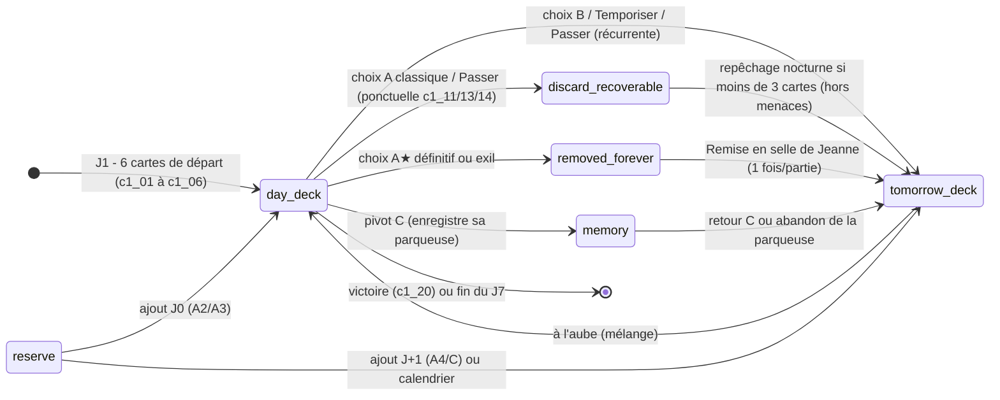

### 1.2 Calendrier des 7 jours

```mermaid
flowchart LR
  classDef card fill:#bfdbfe,stroke:#1d4ed8,stroke-width:3px,color:#000
  classDef thr fill:#fecaca,stroke:#b91c1c,stroke-width:3px,color:#000
  classDef cx fill:#fef2f2,stroke:#b91c1c,color:#000
  classDef nw fill:#e9d5ff,stroke:#6d28d9,color:#000
  classDef win fill:#fde047,stroke:#a16207,stroke-width:3px,color:#000
  J1["📅 J1<br/>6 cartes de départ<br/>c1_01 → c1_06 dans l'ordre"]:::card
  J2["📅 J2<br/>c1_13 Colporteur<br/>spontané"]:::nw
  J3["📅 J3<br/>c1_17 Notaire<br/>menace centrale · Acte 5 Arg"]:::thr
  J4["📅 J4<br/>c1_14 Marché du bourg<br/>spontané"]:::nw
  J5["📅 J5<br/>c1_21 Nuit de grêle<br/>menace · Acte 6 Arg"]:::thr
  J6["📅 J6<br/>c1_22 Inspection<br/>menace · Acte 7 Arg"]:::thr
  J7["📅 J7<br/>A4 et C forcés en now<br/>(jamais les B) · Acte 8 Arg"]:::cx
  FIN["🌙 Nuit du J7<br/>SURVIE si Acte et Vie ≥ 1<br/>sinon TEMPS ÉCOULÉ"]:::win
  J1 --> J2 --> J3 --> J4 --> J5 --> J6 --> J7 --> FIN
```

> Le calendrier n'ajoute une carte que si elle n'est ni en `removed_forever` ni déjà présente. Prix du notaire : **5 Arg (J ≤ 4), 6 (J5), 7 (J6), 8 (J7)** — ou `-2 $` avec `3 L` (*en nature*).

### 1.3 Séquence exacte de la nuit (`end_of_day`)

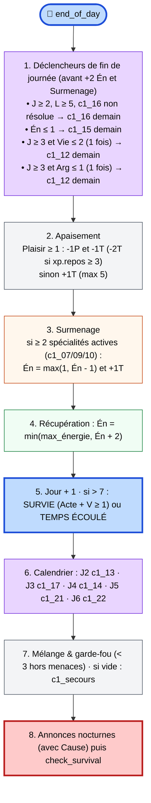

### 1.4 Les 3 voies de victoire

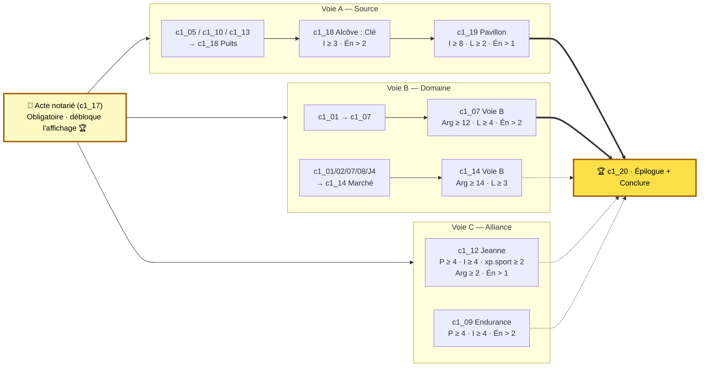

### 1.5 Carte des liens entre les 23 cartes

> Épaisse = **J0 immédiat** · pleine = **J0 plus tard** · pointillée = **J+1 / déclencheur ou calendrier**.

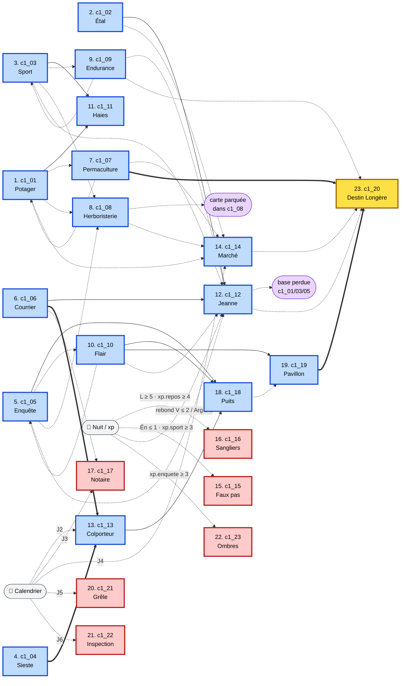

---

## 2. Les 24 cartes, une par une

## 🃏 Carte 1 — `c1_01_aller_potager` · Aller au potager

| Type | Image de fond | Lieu | Rôle |
| :--- | :--- | :--- | :--- |
| `COMPETENCE` | `carte01_campagne_potager.png` | Potager clos à l'aube | Socle agricole (`Légumes`, `xp.potager`). |

**Arrivée en jeu :** J1 (carte n°1) · Retour auto si c1_07 cédée/retour ou c1_08 vendue/retour · Jeanne « Remise en selle » (J+1).

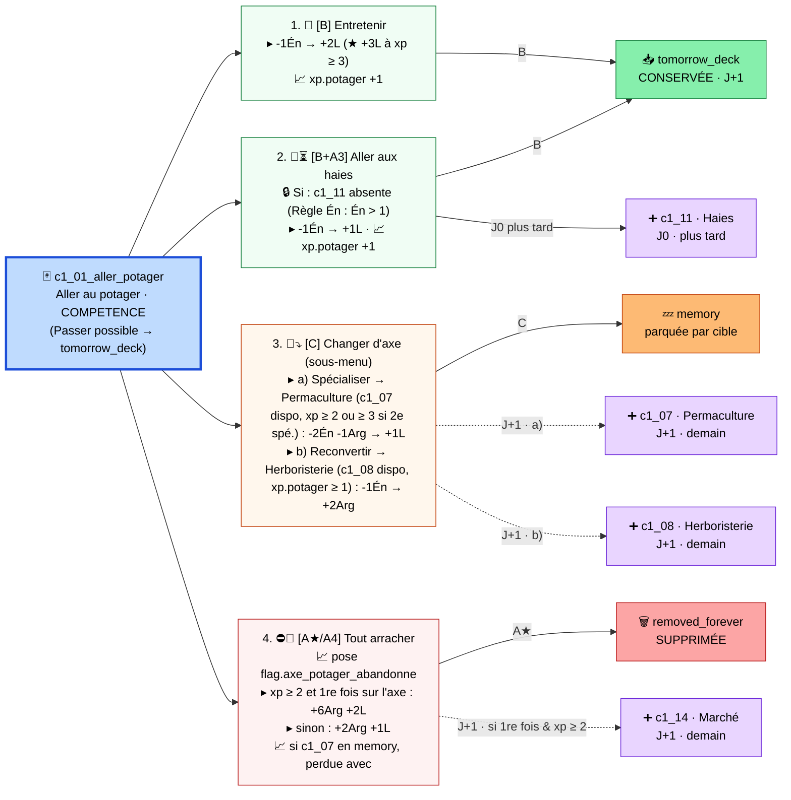

**Points clés :** `c1_01 → c1_08` exige `xp.potager ≥ 1` (ferme le cash rapide J1). `flag.axe_potager_abandonne` empêche le double encaissement après cession de `c1_07`.

---

## 🃏 Carte 2 — `c1_02_vendre_legumes` · Vendre ses légumes au portail

| Type | Image de fond | Lieu | Rôle |
| :--- | :--- | :--- | :--- |
| `ACTIVITE` | `carte02_campagne_etal_legumes.png` | Portail et tréteaux | Convertisseur `Légumes → Argent` par paliers. |

**Arrivée en jeu :** J1 (carte n°2).

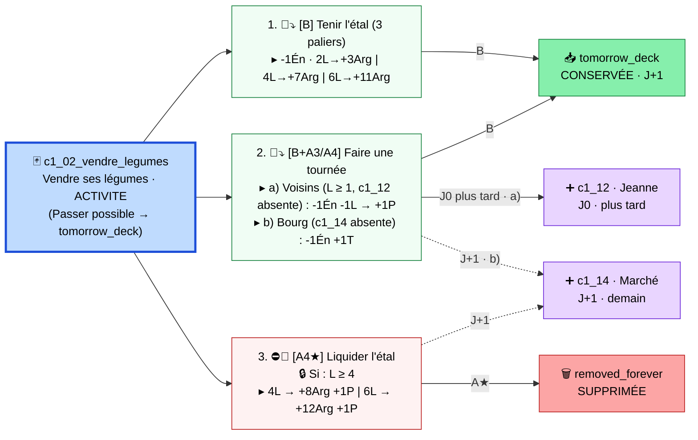

**Points clés :** `Passer` remplace l'ancien choix « Fermer » tout en conservant l'étal pour demain.

---

## 🃏 Carte 3 — `c1_03_activite_sportive` · Activité sportive dans les chemins

| Type | Image de fond | Lieu | Rôle |
| :--- | :--- | :--- | :--- |
| `COMPETENCE` | `carte03_campagne_sport.png` | Chemin creux boisé | Plaisir, `endurance` (max Én 7 puis 8), `xp.sport` et `xp.cueillette`. |

**Arrivée en jeu :** J1 (carte n°3) · Retour auto si c1_09 cédée/retour ou c1_08 vendue/retour · Jeanne « Remise en selle » (J+1).

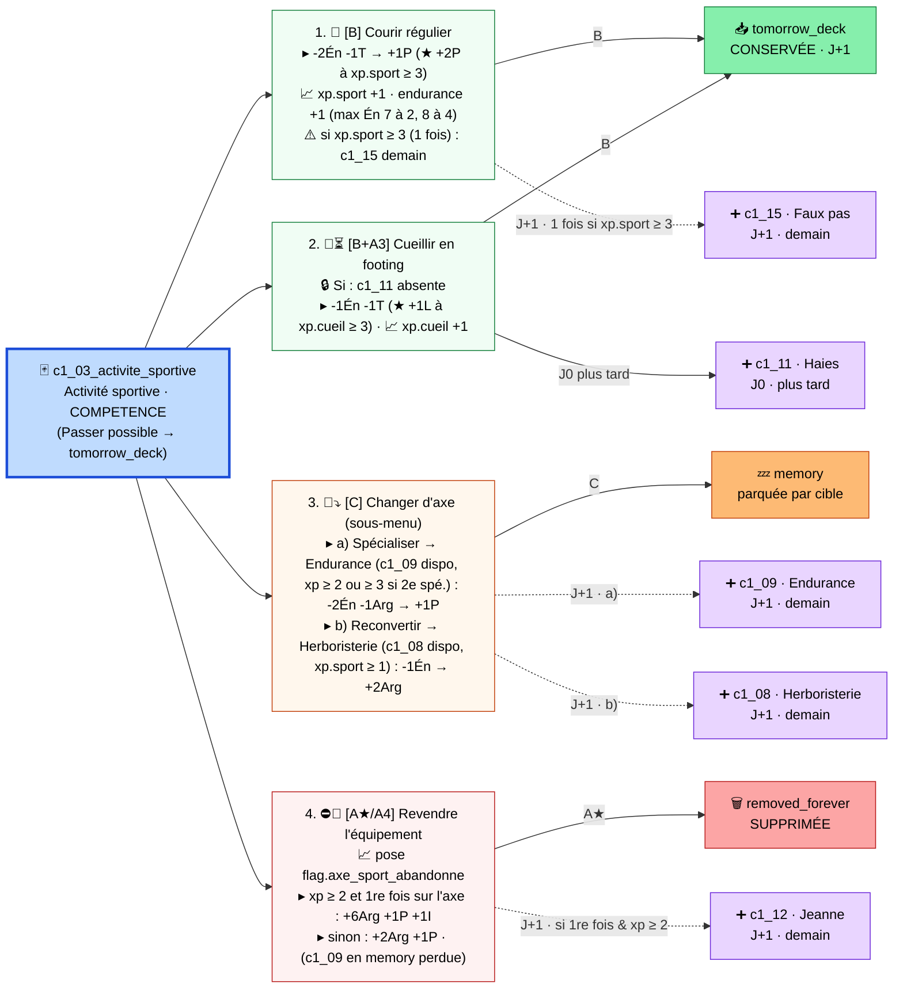

---

## 🃏 Carte 4 — `c1_04_sieste_tilleul` · Faire la sieste sous le tilleul

| Type | Image de fond | Lieu | Rôle |
| :--- | :--- | :--- | :--- |
| `ACTIVITE` | `carte04_campagne_sieste.png` | Hamac sous le tilleul | Vanne Énergie / Tension et conversion `Légumes → Énergie`. |

**Arrivée en jeu :** J1 (carte n°4).

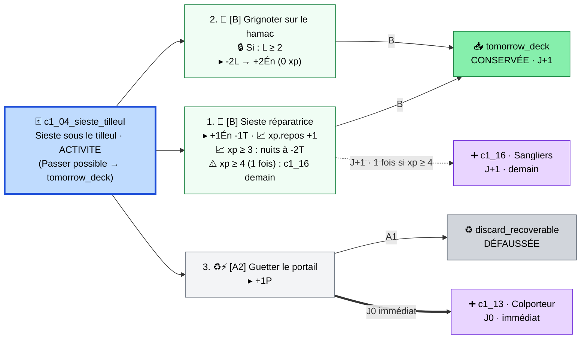

---

## 🃏 Carte 5 — `c1_05_investiguer_domaine` · Investiguer le domaine

| Type | Image de fond | Lieu | Rôle |
| :--- | :--- | :--- | :--- |
| `COMPETENCE` | `carte05_campagne_enquete.png` | Archives et bornes | Socle Voie A (`Indices`, `xp.enquete`). |

**Arrivée en jeu :** J1 (carte n°5) · Retour auto si c1_10 cédée/retour ou c1_08 vendue/retour · Jeanne « Remise en selle » (J+1).

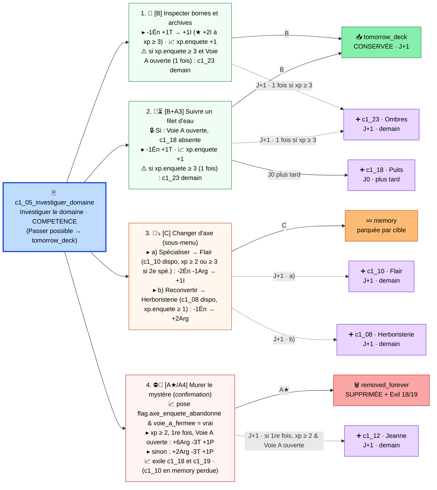

---

## 🃏 Carte 6 — `c1_06_courrier_et_route` · Le courrier et les passants

| Type | Image de fond | Lieu | Rôle |
| :--- | :--- | :--- | :--- |
| `EVENEMENT` | `carte06_campagne_courrier.png` | Portail communal | Aiguillage J1 unique (aucun choix `Passer`). |

**Arrivée en jeu :** J1 (carte n°6).

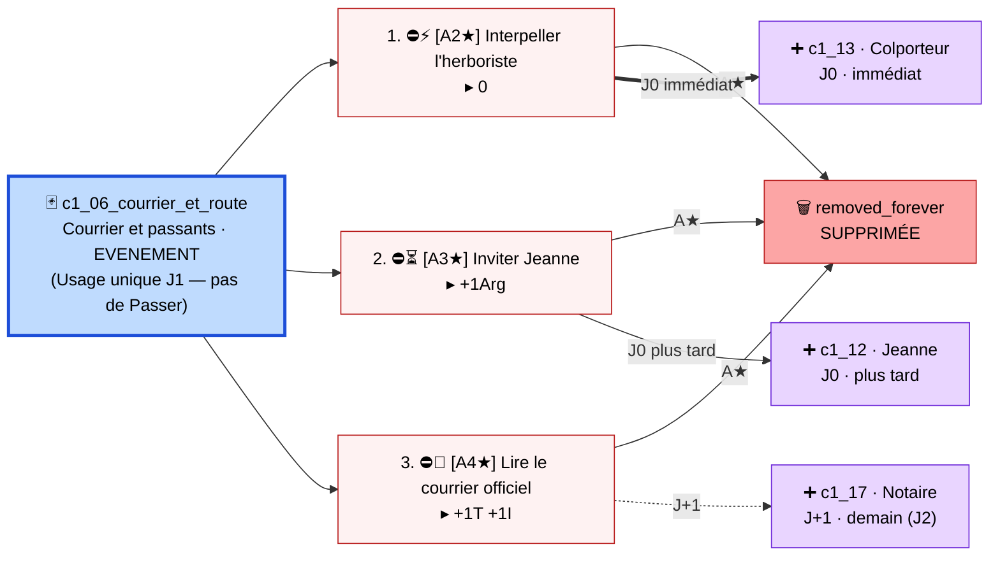

---

## 🃏 Carte 7 — `c1_07_potager_permaculture` · Potager en permaculture

| Type | Image de fond | Lieu | Rôle |
| :--- | :--- | :--- | :--- |
| `COMPETENCE_AVANCEE` | `carte07_campagne_permaculture.png` | Buttes paillées | Spécialité Voie B (`+4/+5 L`), bail cessible, retour `c1_01`. |

**Arrivée en jeu :** J+1 via `c1_01` « Permaculture » (`C`).

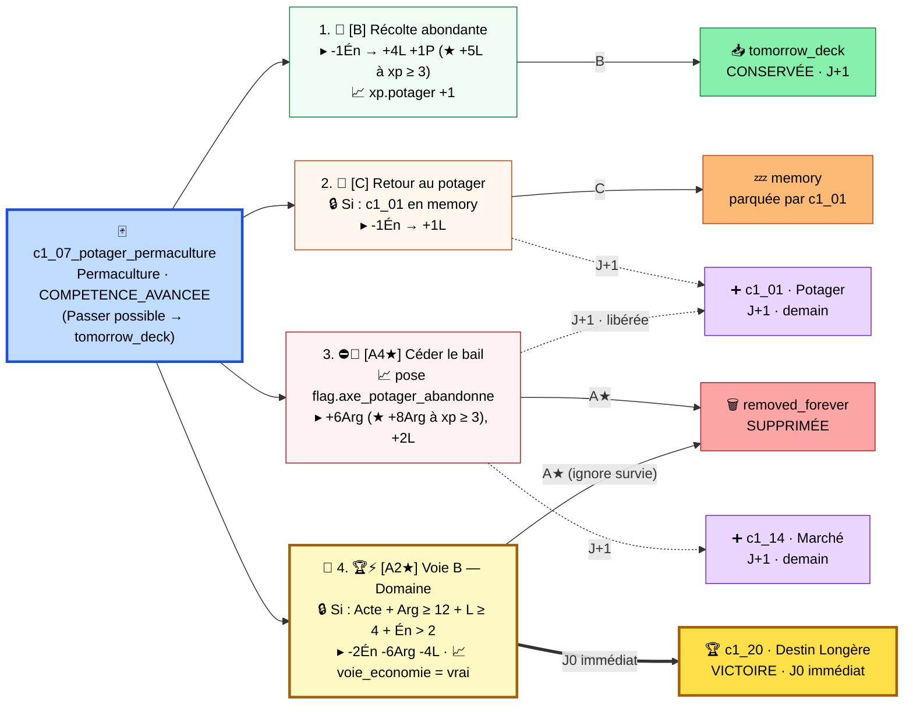

---

## 🃏 Carte 8 — `c1_08_herboristerie_jardin` · Jardin d'herbes médicinales

| Type | Image de fond | Lieu | Rôle |
| :--- | :--- | :--- | :--- |
| `COMPETENCE_AVANCEE` | `carte08_campagne_herboristerie.png` | Appentis et alambic | Trésorerie directe (`+3 Arg`) et refuge « autre nature » pour base parquée. |

**Arrivée en jeu :** J+1 via `c1_01` / `c1_03` / `c1_05` (`C`, dès `xp ≥ 1`).

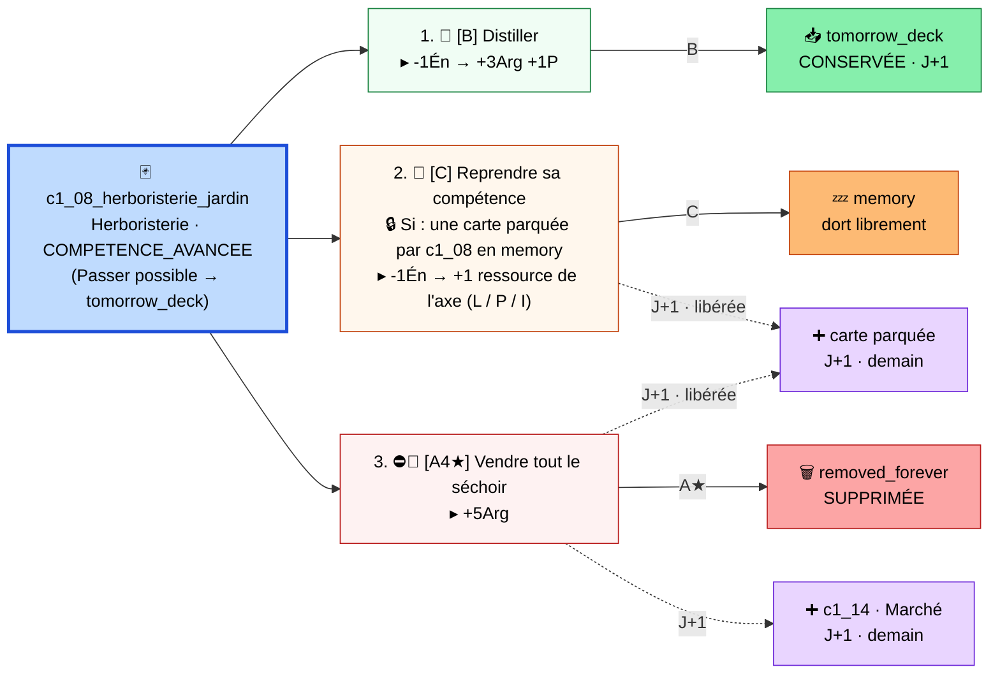

---

## 🃏 Carte 9 — `c1_09_endurance_athletique` · Endurance d'athlète

| Type | Image de fond | Lieu | Rôle |
| :--- | :--- | :--- | :--- |
| `COMPETENCE_AVANCEE` | `carte09_campagne_endurance.png` | Sentier de crête | Spécialité Voie C ; monte `endurance` et devient gratuite en Én à `xp ≥ 3`. |

**Arrivée en jeu :** J+1 via `c1_03` « Endurance athlétique » (`C`).

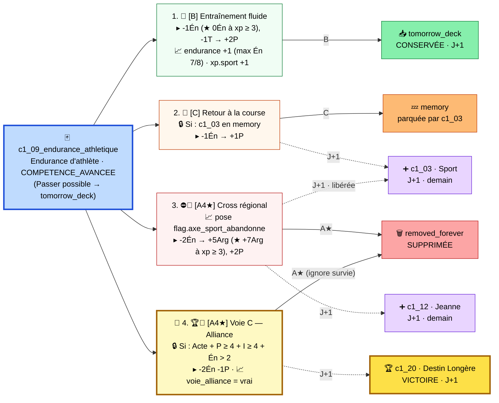

---

## 🃏 Carte 10 — `c1_10_flair_enquetrice` · Flair d'enquêtrice

| Type | Image de fond | Lieu | Rôle |
| :--- | :--- | :--- | :--- |
| `COMPETENCE_AVANCEE` | `carte10_campagne_enquete_carnet.png` | Bureau tardif | Spécialité Voie A (`+2/+3 I`), localise `c1_18` puis `c1_19`. |

**Arrivée en jeu :** J+1 via `c1_05` « Flair d'enquêtrice » (`C`).

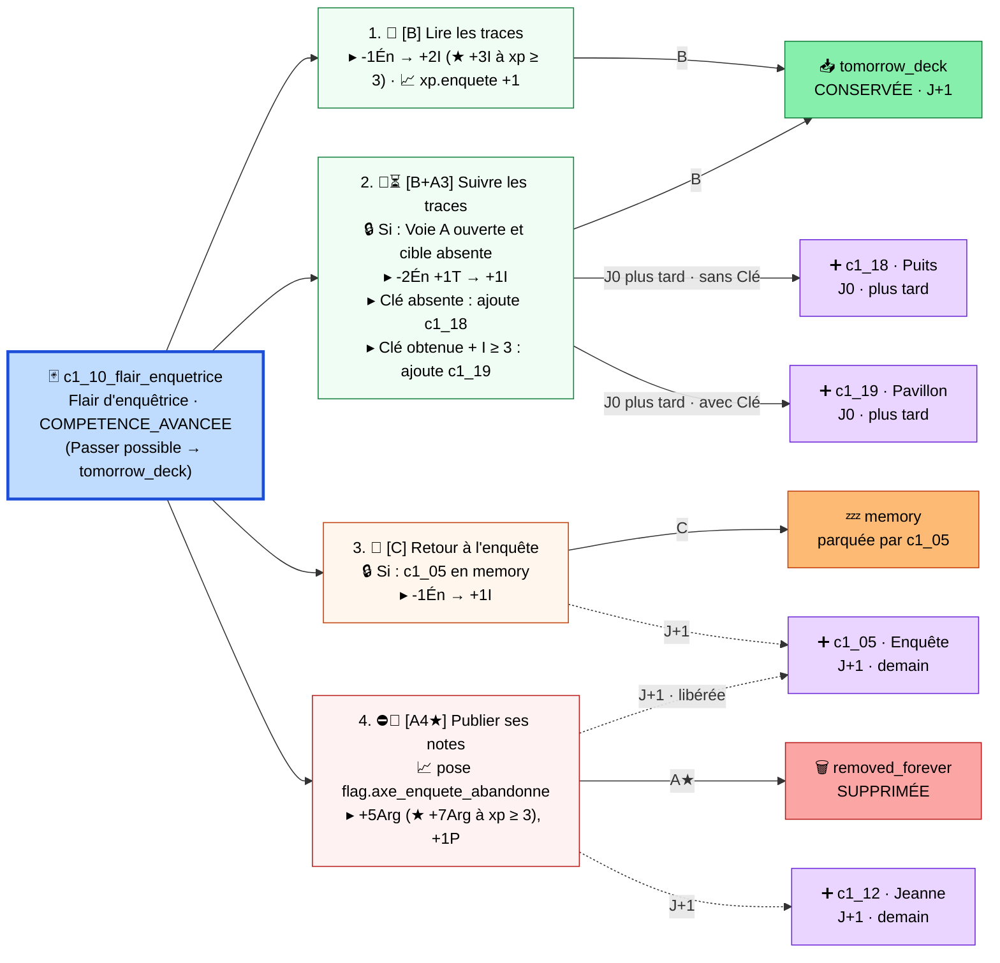

---

## 🃏 Carte 11 — `c1_11_cueillette_haies` · Cueillette dans les haies

| Type | Image de fond | Lieu | Rôle |
| :--- | :--- | :--- | :--- |
| `ACTIVITE` | `carte11_campagne_haies.png` | Haies sauvages | Appoint gratuit (0 Én) pour Énergie, Légumes ou Tension (`xp.cueillette`). |

**Arrivée en jeu :** J0 plus tard (`A3`) via `c1_01` « Aller aux haies » ou `c1_03` « Cueillir en footing ».

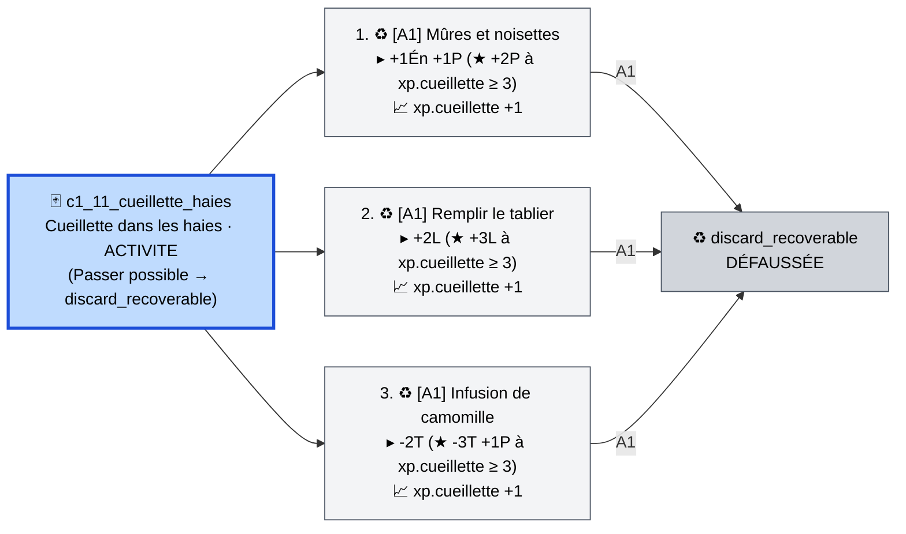

---

## 🃏 Carte 12 — `c1_12_voisine_jeanne` · La voisine Jeanne

| Type | Image de fond | Lieu | Rôle |
| :--- | :--- | :--- | :--- |
| `RENCONTRE` | `carte12_campagne_voisine_jeanne.png` | Clôture mitoyenne | Filet de sécurité (soin, avance, remise en selle) et Voie C (`xp.sport ≥ 2`). |

**Arrivée en jeu :** J0 plus tard (`c1_02`, `c1_06`) · J+1 (`c1_03`, `c1_05`, `c1_09`, `c1_10`) · Rebond nuit `J ≥ 3` (`V ≤ 2` 1×, `Arg ≤ 1` 1×).

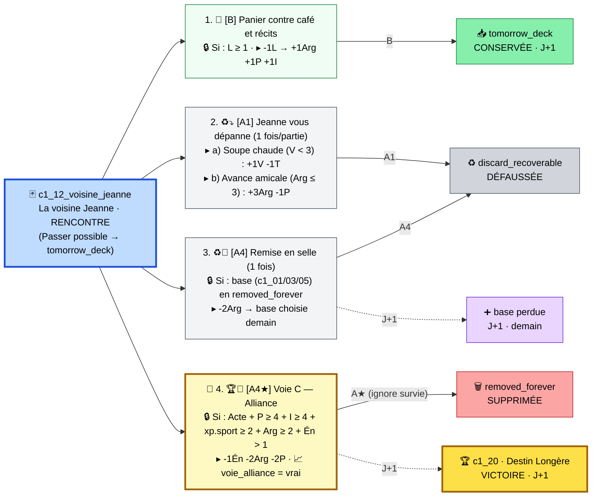

---

## 🃏 Carte 13 — `c1_13_colporteur_herboriste` · Le colporteur herboriste

| Type | Image de fond | Lieu | Rôle |
| :--- | :--- | :--- | :--- |
| `RENCONTRE` | `carte13_campagne_colporteur.png` | Charreton au portail | Convertit l'Argent en Légumes, Énergie, calme ou Indices (+ accès Puits). |

**Arrivée en jeu :** J2 spontané (calendrier) · J0 immédiat via `c1_04` ou `c1_06`.

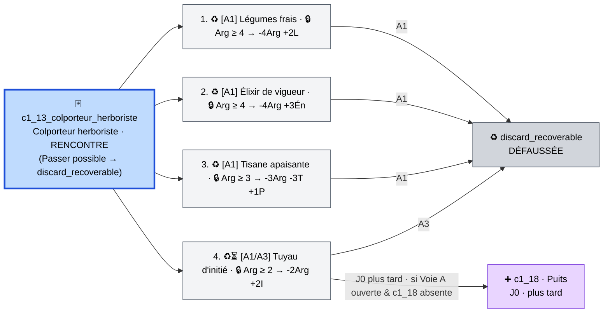

---

## 🃏 Carte 14 — `c1_14_marche_du_bourg` · Le grand marché du bourg

| Type | Image de fond | Lieu | Rôle |
| :--- | :--- | :--- | :--- |
| `EVENEMENT` | `carte14_campagne_marche.png` | Place du bourg | Gros échanges (`Légumes ↔ Argent`), détente et conclusion Voie B. |

**Arrivée en jeu :** J4 spontané (calendrier) · J+1 via `c1_01`, `c1_02`, `c1_07`, `c1_08`.

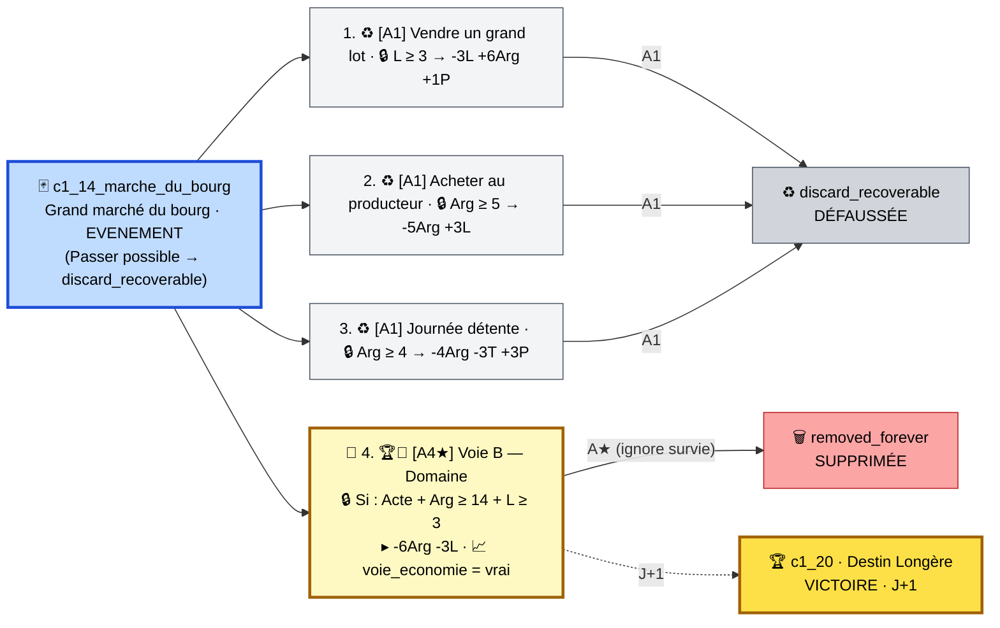

---

## 🃏 Carte 15 — `c1_15_faux_pas_sentier` · Faux pas sur le sentier

| Type | Image de fond | Lieu | Rôle |
| :--- | :--- | :--- | :--- |
| `MENACE` | `carte12_campagne_faux_pas.png` | Talus pierreux | Menace ponctuelle (`Én ≤ 1` ou `xp.sport ≥ 3`) + temporisation croissante. |

**Arrivée en jeu :** Fin de journée `Én ≤ 1` (répétable) · `xp.sport ≥ 3` (1×).

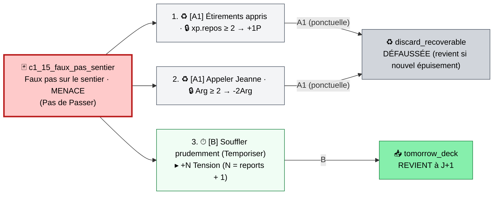

---

## 🃏 Carte 16 — `c1_16_sangliers_potager` · Sangliers au potager

| Type | Image de fond | Lieu | Rôle |
| :--- | :--- | :--- | :--- |
| `MENACE` | `carte16_campagne_sangliers.png` | Potager à l'aube | Menace d'avidité (`L ≥ 5`) ou flânerie (`xp.repos ≥ 4`). |

**Arrivée en jeu :** Fin de journée `J ≥ 2 & L ≥ 5` · `xp.repos ≥ 4` (1×).

```mermaid
flowchart LR
  classDef thr fill:#fecaca,stroke:#b91c1c,stroke-width:3px,color:#000
  classDef ck fill:#f0fdf4,stroke:#15803d,color:#000
  classDef cx fill:#fef2f2,stroke:#b91c1c,color:#000
  classDef pk fill:#86efac,stroke:#15803d,color:#000
  classDef px fill:#fca5a5,stroke:#b91c1c,color:#000
  CARD["🃏 c1_16_sangliers_potager<br/>Sangliers au potager · MENACE<br/>(Pas de Passer)"]:::thr
  K1["1. ⛔ [A★] Clôture solide · 🔒 Arg ≥ 3, Én > 1 → -1Én -3Arg · 📈 résolue"]:::cx
  K2["2. ⛔ [A★] Pourchasser · 🔒 xp.sport ≥ 2, Én > 2 → -2Én +1P · 📈 résolue"]:::cx
  K3["3. ⛔ [A★] Répulsif de ronces · 🔒 xp.cueil ≥ 2, Én > 1 → -1Én +1I · 📈 résolue"]:::cx
  K4["4. ⏱ [B] Épouvantail de fortune (Temporiser)<br/>▸ +N Tension (N = reports + 1)"]:::ck
  CARD --> K1 -->|"A★"| PX["🗑️ removed_forever<br/>RÉSOLUE"]:::px
  CARD --> K2 -->|"A★"| PX
  CARD --> K3 -->|"A★"| PX
  CARD --> K4 -->|"B"| PK["📥 tomorrow_deck<br/>REVIENT à J+1"]:::pk
```

---

## 🃏 Carte 17 — `c1_17_courrier_notaire` · Courrier du notaire

| Type | Image de fond | Lieu | Rôle |
| :--- | :--- | :--- | :--- |
| `MENACE_CENTRALE` | `carte17_campagne_notaire.png` | Enveloppe scellée | Passage obligé délivrant l'Acte notarié (argent ou nature). |

**Arrivée en jeu :** J3 (calendrier) ou J2 via `c1_06`.

```mermaid
flowchart LR
  classDef thr fill:#fecaca,stroke:#b91c1c,stroke-width:3px,color:#000
  classDef ck fill:#f0fdf4,stroke:#15803d,color:#000
  classDef cx fill:#fef2f2,stroke:#b91c1c,color:#000
  classDef pk fill:#86efac,stroke:#15803d,color:#000
  classDef px fill:#fca5a5,stroke:#b91c1c,color:#000
  CARD["🃏 c1_17_courrier_notaire<br/>Courrier du notaire · MENACE_CENTRALE<br/>(Tarif : 5$ J≤4 · 6$ J5 · 7$ J6 · 8$ J7)"]:::thr
  K1["1. ⛔ [A★] Régler en argent · 🔒 Arg ≥ tarif → -tarif Arg +1I · 📈 Acte = vrai"]:::cx
  K2["2. ⛔ [A★] Régler en nature · 🔒 Arg ≥ tarif - 2, L ≥ 3 → -(tarif - 2)Arg -3L · 📈 Acte = vrai"]:::cx
  K3["3. ⏱ [B] Repousser le rendez-vous (Temporiser)<br/>▸ +N Tension (N = reports + 1)"]:::ck
  CARD --> K1 -->|"A★"| PX["🗑️ removed_forever<br/>Acte acquis"]:::px
  CARD --> K2 -->|"A★"| PX
  CARD --> K3 -->|"B"| PK["📥 tomorrow_deck<br/>REVIENT à J+1"]:::pk
```

---

## 🃏 Carte 18 — `c1_18_puits_pierres_grises` · Le puits aux pierres grises

| Type | Image de fond | Lieu | Rôle |
| :--- | :--- | :--- | :--- |
| `MYSTERE` | `carte18_campagne_puits.png` | Puits mousseux | Clé de la Source (`Voie A`) ou vente irréversible avant prise de la Clé. |

**Arrivée en jeu :** J0 plus tard (`c1_05`, `c1_10`, `c1_13`).

```mermaid
flowchart LR
  classDef card fill:#bfdbfe,stroke:#1d4ed8,stroke-width:3px,color:#000
  classDef ck fill:#f0fdf4,stroke:#15803d,color:#000
  classDef cd fill:#f3f4f6,stroke:#4b5563,color:#000
  classDef cx fill:#fef2f2,stroke:#b91c1c,color:#000
  classDef pk fill:#86efac,stroke:#15803d,color:#000
  classDef pd fill:#d1d5db,stroke:#4b5563,color:#000
  classDef px fill:#fca5a5,stroke:#b91c1c,color:#000
  classDef nw fill:#e9d5ff,stroke:#6d28d9,color:#000
  CARD["🃏 c1_18_puits_pierres_grises<br/>Le puits · MYSTERE<br/>(Passer possible → tomorrow_deck)"]:::card
  K1["1. 🔁 [B] Étudier la margelle<br/>▸ -1Én → +1I · 📈 xp.enquete +1"]:::ck
  K2["2. ♻🌙 [A4] Descendre à l'alcôve<br/>🔒 Si : Voie A ouverte, Clé = faux, I ≥ 3, Én > 2<br/>▸ -2Én +2T → +2I · 📈 Clé = vrai"]:::cd
  K3["3. ⛔ [A★] Vendre le secret (confirmation)<br/>🔒 Si : Clé = faux<br/>▸ +5Arg +1P · 📈 voie_a_fermee = vrai · exile c1_19"]:::cx
  CARD --> K1 -->|"B"| PK["📥 tomorrow_deck<br/>CONSERVÉE · J+1"]:::pk
  CARD --> K2 -->|"A4"| PD["♻️ discard_recoverable<br/>DÉFAUSSÉE"]:::pd
  K2 -.->|"J+1"| N19["➕ c1_19 · Pavillon<br/>J+1 · demain"]:::nw
  CARD --> K3 -->|"A★"| PX["🗑️ removed_forever<br/>SUPPRIMÉE + Exil c1_19"]:::px
```

---

## 🃏 Carte 19 — `c1_19_pavillon_scelle` · Le Pavillon de la Source

| Type | Image de fond | Lieu | Rôle |
| :--- | :--- | :--- | :--- |
| `MYSTERE` | `carte19_campagne_pavillon.png` | Édifice octogonal | Sanctuaire final Voie A. |

**Arrivée en jeu :** J0 plus tard (`c1_10`) · J+1 (`c1_18`).

```mermaid
flowchart LR
  classDef card fill:#bfdbfe,stroke:#1d4ed8,stroke-width:3px,color:#000
  classDef ck fill:#f0fdf4,stroke:#15803d,color:#000
  classDef cw fill:#fef9c3,stroke:#a16207,stroke-width:3px,color:#000
  classDef pk fill:#86efac,stroke:#15803d,color:#000
  classDef px fill:#fca5a5,stroke:#b91c1c,color:#000
  classDef win fill:#fde047,stroke:#a16207,stroke-width:3px,color:#000
  CARD["🃏 c1_19_pavillon_scelle<br/>Pavillon de la Source · MYSTERE<br/>(Passer possible → tomorrow_deck)"]:::card
  K1["🔐 1. 🏆⚡ [A2★] Voie A — Source<br/>🔒 Si : Acte + Clé + I ≥ 8 + L ≥ 2 + Én > 1<br/>▸ -1Én -2L · 📈 voie_mystere = vrai"]:::cw
  K2["2. 🔁 [B] Déchiffrer les glyphes<br/>▸ -1Én +1T → +2I · 📈 xp.enquete +1"]:::ck
  CARD --> K1 -->|"A★ (ignore survie)"| PX["🗑️ removed_forever<br/>SUPPRIMÉE"]:::px
  K1 ==>|"J0 immédiat"| N20["🏆 c1_20 · Destin Longère<br/>VICTOIRE · J0 immédiat"]:::win
  CARD --> K2 -->|"B"| PK["📥 tomorrow_deck<br/>CONSERVÉE · J+1"]:::pk
```

---

## 🃏 Carte 20 — `c1_21_nuit_de_grele` · Nuit de grêle

| Type | Image de fond | Lieu | Rôle |
| :--- | :--- | :--- | :--- |
| `MENACE` | `carte21_campagne_grele.png` | Potager sous orage | Menace saisonnière J5, 3 parades + temporisation. |

**Arrivée en jeu :** J5 (calendrier).

```mermaid
flowchart LR
  classDef thr fill:#fecaca,stroke:#b91c1c,stroke-width:3px,color:#000
  classDef ck fill:#f0fdf4,stroke:#15803d,color:#000
  classDef cx fill:#fef2f2,stroke:#b91c1c,color:#000
  classDef pk fill:#86efac,stroke:#15803d,color:#000
  classDef px fill:#fca5a5,stroke:#b91c1c,color:#000
  CARD["🃏 c1_21_nuit_de_grele<br/>Nuit de grêle · MENACE<br/>(Pas de Passer)"]:::thr
  K1["1. ⛔ [A★] Tendre des bâches · 🔒 Arg ≥ 2, Én > 1 → -1Én -2Arg"]:::cx
  K2["2. ⛔ [A★] Cloches de paille · 🔒 xp.potager ≥ 2, Én > 1 → -1Én +1P"]:::cx
  K3["3. ⛔ [A★] Rentrer en hâte · 🔒 xp.sport ≥ 2, Én > 2 → -2Én +1L"]:::cx
  K4["4. ⏱ [B] Colmater (Temporiser) · ▸ +N Tension (N = reports + 1)"]:::ck
  CARD --> K1 -->|"A★"| PX["🗑️ removed_forever<br/>RÉSOLUE"]:::px
  CARD --> K2 -->|"A★"| PX
  CARD --> K3 -->|"A★"| PX
  CARD --> K4 -->|"B"| PK["📥 tomorrow_deck<br/>REVIENT à J+1"]:::pk
```

---

## 🃏 Carte 21 — `c1_22_visite_inspection` · Visite d'inspection

| Type | Image de fond | Lieu | Rôle |
| :--- | :--- | :--- | :--- |
| `MENACE` | `carte22_campagne_inspection.png` | Portail et voiture grise | Contrôle J6 valorisant l'Acte. |

**Arrivée en jeu :** J6 (calendrier).

```mermaid
flowchart LR
  classDef thr fill:#fecaca,stroke:#b91c1c,stroke-width:3px,color:#000
  classDef ck fill:#f0fdf4,stroke:#15803d,color:#000
  classDef cx fill:#fef2f2,stroke:#b91c1c,color:#000
  classDef pk fill:#86efac,stroke:#15803d,color:#000
  classDef px fill:#fca5a5,stroke:#b91c1c,color:#000
  CARD["🃏 c1_22_visite_inspection<br/>Visite d'inspection · MENACE<br/>(Pas de Passer)"]:::thr
  K1["1. ⛔ [A★] Présenter l'Acte · 🔒 Acte = vrai → +1P"]:::cx
  K2["2. ⛔ [A★] Relevés cadastraux · 🔒 I ≥ 4, Én > 1 → -1Én"]:::cx
  K3["3. ⛔ [A★] Payer l'amende · 🔒 Arg ≥ 3 → -3Arg"]:::cx
  K4["4. ⏱ [B] Promettre sous 24 h (Temporiser) · ▸ +N Tension (N = reports + 1)"]:::ck
  CARD --> K1 -->|"A★"| PX["🗑️ removed_forever<br/>RÉSOLUE"]:::px
  CARD --> K2 -->|"A★"| PX
  CARD --> K3 -->|"A★"| PX
  CARD --> K4 -->|"B"| PK["📥 tomorrow_deck<br/>REVIENT à J+1"]:::pk
```

---

## 🃏 Carte 22 — `c1_23_ombres_pavillon` · Ombres au pavillon

| Type | Image de fond | Lieu | Rôle |
| :--- | :--- | :--- | :--- |
| `MENACE` | `carte24_campagne_ombres.png` | Jardin nocturne | Menace d'avidité Enquête (`xp.enquete ≥ 3` si Voie A ouverte). |

**Arrivée en jeu :** Déclencheur `xp.enquete ≥ 3` (1×, Voie A ouverte) → J+1.

```mermaid
flowchart LR
  classDef thr fill:#fecaca,stroke:#b91c1c,stroke-width:3px,color:#000
  classDef ck fill:#f0fdf4,stroke:#15803d,color:#000
  classDef cx fill:#fef2f2,stroke:#b91c1c,color:#000
  classDef pk fill:#86efac,stroke:#15803d,color:#000
  classDef px fill:#fca5a5,stroke:#b91c1c,color:#000
  CARD["🃏 c1_23_ombres_pavillon<br/>Ombres au pavillon · MENACE<br/>(Pas de Passer)"]:::thr
  K1["1. ⛔ [A★] Veiller toute la nuit · 🔒 Én > 2 → -2Én +1T +2I"]:::cx
  K2["2. ⛔ [A★] Allumer des lampes · 🔒 Arg ≥ 1 → -1Arg"]:::cx
  K3["3. ⏱ [B] Écouter sans bouger (Temporiser) · ▸ +N Tension (N = reports + 1)"]:::ck
  CARD --> K1 -->|"A★"| PX["🗑️ removed_forever<br/>RÉSOLUE"]:::px
  CARD --> K2 -->|"A★"| PX
  CARD --> K3 -->|"B"| PK["📥 tomorrow_deck<br/>REVIENT à J+1"]:::pk
```

---

## 🃏 Carte 23 — `c1_20_destin_longere` · L'Avenir de la Longère

| Type | Image de fond | Lieu | Rôle |
| :--- | :--- | :--- | :--- |
| `FINAL` | `carte20_campagne_destin_longere.png` | Cour dorée | Épilogue automatique + bouton unique `Conclure` 🏆. |

**Arrivée en jeu :** J0 imm. (`c1_07`, `c1_19`) · J+1 (`c1_09`, `c1_12`, `c1_14`).

```mermaid
flowchart LR
  classDef card fill:#bfdbfe,stroke:#1d4ed8,stroke-width:3px,color:#000
  classDef cw fill:#fef9c3,stroke:#a16207,stroke-width:3px,color:#000
  classDef cx fill:#fef2f2,stroke:#b91c1c,color:#000
  classDef nw fill:#e9d5ff,stroke:#6d28d9,color:#000
  classDef win fill:#fde047,stroke:#a16207,stroke-width:3px,color:#000
  A["c1_19 Pavillon · Voie A"]:::cw ==>|"J0 imm."| F["inv.voie_*"]:::nw
  B1["c1_07 Permaculture · Voie B"]:::cw ==>|"J0 imm."| F
  B2["c1_14 Marché · Voie B"]:::cw -.->|"J+1"| F
  C1["c1_12 Jeanne · Voie C"]:::cw -.->|"J+1"| F
  C2["c1_09 Endurance · Voie C"]:::cw -.->|"J+1"| F
  F --> F20["🃏 c1_20 · Épilogue de la voie accomplie<br/>1 seul bouton : Conclure"]:::card
  F20 -->|"VICTOIRE"| FIN(["🏆 VICTOIRE"]) :::win
  F20 -.->|"non atteinte au J7"| SURV["⏳ Acte + V ≥ 1 : SURVIE<br/>sinon : TEMPS ÉCOULÉ"]:::cx
```

---

## 🃏 Carte T — `c1_secours_journee_calme` · Journée calme

| Type | Image de fond | Lieu | Rôle |
| :--- | :--- | :--- | :--- |
| `TECHNIQUE` | `Potager d’été fleuri et ensoleillé.png` | Cour silencieuse | Filet anti-blocage hors deck si `day_deck` vide. |

```mermaid
flowchart LR
  classDef card fill:#bfdbfe,stroke:#1d4ed8,stroke-width:3px,color:#000
  classDef cd fill:#f3f4f6,stroke:#4b5563,color:#000
  CARD["🃏 c1_secours_journee_calme · TECHNIQUE (hors deck)"]:::card
  K1["1. ♻ Laisser passer → +1Én -1T"]:::cd
  CARD --> K1 --> END(["Nuit (jamais stockée en pile)"])
```

---

## 3. Annexes V10

### 3.1 Bilan du devenir des cartes (hors bouton `Passer`)

| # | Carte | Choix | 📥 B / ⏱ | ♻️ A1–A4 | 🗑️ A★ / 🏆 | 💤 C | Cartes appelées |
| :-: | :--- | :-: | :-: | :-: | :-: | :-: | :--- |
| 1 | `c1_01` Aller au potager | 4 (5 avec ⤵) | 2 | 0 | 1 | 2 | c1_07, c1_08, c1_11, c1_14 |
| 2 | `c1_02` Vendre ses légumes | 3 (6 avec ⤵) | 5 | 0 | 1 | 0 | c1_12, c1_14 |
| 3 | `c1_03` Activité sportive | 4 (5 avec ⤵) | 2 | 0 | 1 | 2 | c1_08, c1_09, c1_11, c1_12 |
| 4 | `c1_04` Sieste sous le tilleul | 3 | 2 | 1 | 0 | 0 | c1_13 |
| 5 | `c1_05` Investiguer le domaine | 4 (5 avec ⤵) | 2 | 0 | 1 | 2 | c1_08, c1_10, c1_12, c1_18 |
| 6 | `c1_06` Courrier et passants | 3 | 0 | 0 | 3 | 0 | c1_12, c1_13, c1_17 |
| 7 | `c1_07` Permaculture | 4 | 1 | 0 | 2 | 1 | c1_01, c1_14, c1_20 |
| 8 | `c1_08` Herboristerie | 3 | 1 | 0 | 1 | 1 | base parquée, c1_14 |
| 9 | `c1_09` Endurance d'athlète | 4 | 1 | 0 | 2 | 1 | c1_03, c1_12, c1_20 |
| 10 | `c1_10` Flair d'enquêtrice | 4 | 2 | 0 | 1 | 1 | c1_05, c1_12, c1_18, c1_19 |
| 11 | `c1_11` Cueillette dans les haies | 3 | 0 | 3 | 0 | 0 | – |
| 12 | `c1_12` Voisine Jeanne | 4 (5 avec ⤵) | 1 | 3 | 1 | 0 | base perdue, c1_20 |
| 13 | `c1_13` Colporteur herboriste | 4 | 0 | 4 | 0 | 0 | c1_18 |
| 14 | `c1_14` Grand marché du bourg | 4 | 0 | 3 | 1 | 0 | c1_20 |
| 15 | `c1_15` Faux pas sur le sentier | 3 | 1 | 2 | 0 | 0 | – |
| 16 | `c1_16` Sangliers au potager | 4 | 1 | 0 | 3 | 0 | – |
| 17 | `c1_17` Courrier du notaire | 3 | 1 | 0 | 2 | 0 | – |
| 18 | `c1_18` Puits aux pierres grises | 3 | 1 | 1 | 1 | 0 | c1_19 |
| 19 | `c1_19` Pavillon de la Source | 2 | 1 | 0 | 1 | 0 | c1_20 |
| 20 | `c1_21` Nuit de grêle | 4 | 1 | 0 | 3 | 0 | – |
| 21 | `c1_22` Visite d'inspection | 4 | 1 | 0 | 3 | 0 | – |
| 22 | `c1_23` Ombres au pavillon | 3 | 1 | 0 | 2 | 0 | – |
| 23 | `c1_20` Avenir de la Longère | 1 | – | – | – | – | Fin de partie |
| T | `c1_secours` Journée calme | 1 | 0 | 1 | 0 | 0 | – |

### 3.2 Qui appelle qui & Déclencheurs automatiques V10

| Déclencheur / Source | Condition | Carte appelée | Timing | Fréquence |
| :--- | :--- | :--- | :---: | :--- |
| Calendrier | J2 / J3 / J4 / J5 / J6 | `c1_13` / `c1_17` / `c1_14` / `c1_21` / `c1_22` | J2..J6 | spontané / menace |
| Fin de journée | `J ≥ 2`, `Légumes ≥ 5`, `c1_16` non résolue | `c1_16` Sangliers | J+1 | chaque soir tant que vrai |
| Fin de journée | `Énergie ≤ 1` | `c1_15` Faux pas | J+1 | chaque soir tant que vrai |
| Fin de journée | `J ≥ 3` et `Vie ≤ 2` / `Arg ≤ 1` | `c1_12` Jeanne | J+1 | **1 fois par seuil** |
| Compteur xp | `xp.sport ≥ 3` / `xp.enquete ≥ 3` / `xp.repos ≥ 4` | `c1_15` / `c1_23` / `c1_16` | J+1 | **1 fois chacun** |
| Deck vide | `day_deck` vide après mélange | `c1_secours` Journée calme | J0 | filet anti-blocage |

### 3.3 Points techniques relevés pour l'implémentation Godot (V10)

1. **`carte12_campagne_faux_pas.png` (`c1_15`) :** partage le préfixe `12` avec `c1_12` (à renommer `carte15_campagne_faux_pas.png` si souhaité, non bloquant).
2. **`c1_17` en nature au J7 :** à J7 (`tarif = 8`), `-(tarif - 2) Arg` coûte **`-6 Arg -3 L`**, ce qui reste cohérent.
3. **`c1_12` Remise en selle :** si plusieurs bases sont en `removed_forever`, ouvrir un sous-menu de sélection (ex. `retour_base` filtré sur `removed`) pour que le joueur choisisse celle à réactiver.
4. **Règle d'or 2 (`Én > coût`) & `⏱ Temporiser` :** gérer le grisage volontaire et l'incrément `{temp.c1_XX}` côté moteur (`ResourceManager` / `DialogTheme`), ainsi que les 4 nouveaux titres de sous-menus `⤵` dans `_is_submenu_opener()`.

---

*Document généré à partir de **`deckV10`** — l'ensemble des diagrammes, conditions, coûts/gains, déclencheurs et destinations reflète intégralement la V10.*